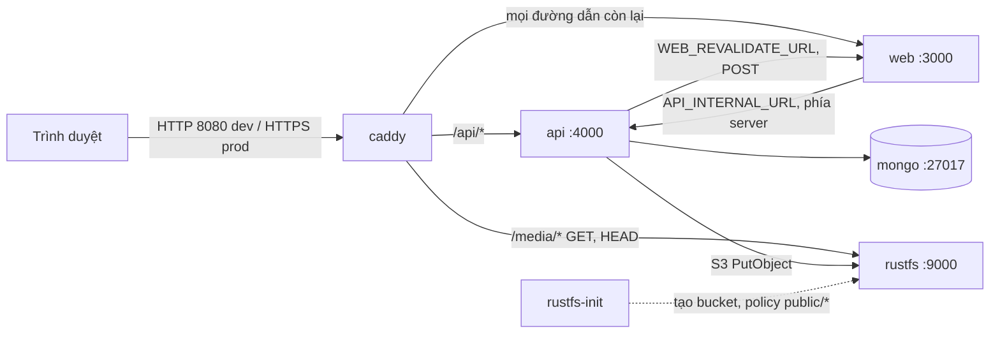
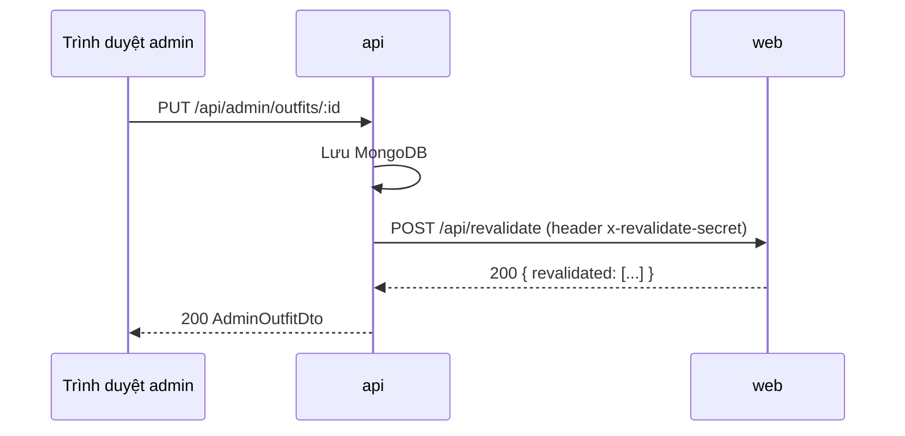
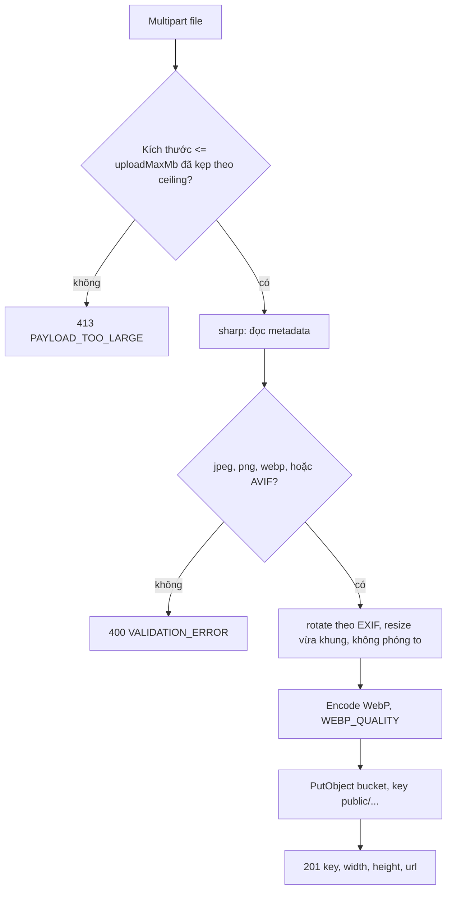

# Kiến trúc hệ thống Under30ss (v1)

Under30ss là trang lookbook "Shop the look": một ảnh người mẫu, các món đồ nối bằng đường chỉ tới từng món, bấm vào món để mở link affiliate. Dữ liệu outfit nằm trong MongoDB, ảnh nằm trong bucket S3 (RustFS). Next.js render trang public phía server để phục vụ SEO; Express API riêng phục vụ dữ liệu và trang quản trị `/admin`.

Tài liệu liên quan: [Quy chuẩn code](./code-standards.md) · [Triển khai](./deployment-guide.md) · [Lịch sử thay đổi](./project-changelog.md) · [Roadmap](./development-roadmap.md)

## Contents
- [Dịch vụ và cổng](#dịch-vụ-và-cổng)
- [Định tuyến Caddy](#định-tuyến-caddy)
- [Mô hình dữ liệu](#mô-hình-dữ-liệu)
- [Bất biến featured](#bất-biến-featured)
- [Luồng revalidate API → web](#luồng-revalidate-api--web)
- [Pipeline ảnh và media](#pipeline-ảnh-và-media)
- [Xác thực và giới hạn đăng nhập](#xác-thực-và-giới-hạn-đăng-nhập)
- [Lỗi, health check, cấu hình](#lỗi-health-check-cấu-hình)

## Dịch vụ và cổng

Stack chạy bằng `infra/docker-compose.yml` (dev, mặc định) và `infra/docker-compose.prod.yml` (override cho production). Compose đặt `name: under30ss`.

| Service | Image / build | Vai trò | Cổng trong mạng compose | Publish ra host |
|---------|---------------|---------|--------------------------|-----------------|
| `caddy` | `caddy:2.11.9` | Reverse proxy, định tuyến, body limit, HTTPS tự động (prod) | 80, 443 | dev: `CADDY_HTTP_PORT` (mặc định 8080) → 80; `CADDY_HTTPS_PORT` (mặc định 8443) → 443. prod: 80 và 443 |
| `web` | `apps/web/Dockerfile` (Next.js 16, output standalone) | Trang public (`/`, `/look/[slug]`), trang admin, `/api/revalidate` | 3000 | Không |
| `api` | `apps/api/Dockerfile` (Express 5, Node 24) | REST API `/api/*`, upload ảnh, session, rate limit | 4000 | Không |
| `mongo` | `mongo:8` | Dữ liệu outfit, admin, settings, session | 27017 | dev: `127.0.0.1:27017`. prod: không publish, bật auth |
| `rustfs` | `rustfs/rustfs:1.0.4` | Object storage tương thích S3 | 9000 (API S3), 9001 (console, không publish) | dev: `127.0.0.1:9000`. prod: không publish |
| `rustfs-permissions` | `alpine:3` | Chạy một lần: `chown` volume dữ liệu cho uid 10001 | — | Không |
| `rustfs-init` | `amazon/aws-cli:2.39.5` | Chạy một lần: tạo bucket, áp policy đọc công khai cho `public/*` | — | Không |

Volume đặt tên: `mongo-data`, `rustfs-data`, `caddy-data`, `caddy-config`. Lệnh `down -v` sẽ xoá các volume này (xem [Triển khai](./deployment-guide.md)).

Thứ tự khởi động (theo `depends_on`): `mongo`, `rustfs-permissions` → `rustfs` → `rustfs-init` (hoàn tất thành công). `api` chờ `mongo` healthy và `rustfs-init` hoàn tất. `web` chờ `api` healthy. `caddy` chờ `rustfs` đã start, `api` và `web` healthy.

## Sơ đồ thành phần



Lưu ý: trình duyệt chỉ gọi cùng origin. Admin gọi `/api/*` tương đối: qua Caddy ở compose/production, qua rewrite của `next dev` (chỉ bật khi `NODE_ENV=development`) khi chạy `pnpm dev` (xem [Triển khai, mục dev](./deployment-guide.md#chạy-local-để-phát-triển-pnpm-dev)).

## Định tuyến Caddy

Cấu hình nằm ở `infra/caddy/Caddyfile`. Thứ tự khối `handle` quan trọng: khối cụ thể nằm trước khối chung.

| Đường dẫn | Đích | Hành vi |
|-----------|------|---------|
| `/api/health*` | Không chuyển tiếp | Caddy trả 404 từ bên ngoài. Healthcheck của compose gọi thẳng `api:4000` |
| `/api/admin/media*` | `api:4000` | Body tối đa `UPLOAD_MAX_MB_CEILING` + 1 MiB (phần overhead multipart). Vượt quá trả 413 JSON `PAYLOAD_TOO_LARGE` |
| `/api/*` | `api:4000` | Chuyển tiếp nguyên trạng |
| `/media/*` | `rustfs:9000`, đường dẫn `/{S3_BUCKET}{path}` | Chỉ `GET` và `HEAD`; method khác trả 405 kèm `Allow: GET, HEAD`. Thêm `X-Content-Type-Options: nosniff`. Query string bị bỏ |
| còn lại | `web:3000` | Trang public, trang admin, asset Next.js |

Các cơ chế đã kiểm chứng khi chạy stack thật:
- Lỗi 413 luôn có `Content-Type: application/json; charset=utf-8` và body `{"error":{"code":"PAYLOAD_TOO_LARGE",...}}`. Thông điệp khớp hằng số `FILE_TOO_LARGE_MESSAGE` trong `apps/api/src/middleware/error-handler-middleware.ts`.
- Giới hạn body của Caddy được tính trong lệnh `command` của service `caddy` (`UPLOAD_BODY_MAX_MB=$$((UPLOAD_MAX_MB_CEILING + 1))`), vì placeholder của Caddyfile không tính số học được.
- Caddy ghi đè `X-Forwarded-For`, nên IP client mà API thấy không thể bị giả qua header.

## Mô hình dữ liệu

Các model Mongoose nằm trong `apps/api/src/models/`. Kiểu dữ liệu chia sẻ và quy tắc validate nằm trong `packages/shared/src/`.

### Outfit

| Trường | Kiểu | Ràng buộc |
|--------|------|-----------|
| `slug` | string | Duy nhất. Regex `^[a-z0-9]+(?:-[a-z0-9]+)*$`, tối đa 80 ký tự |
| `title` | string | 1–120 ký tự |
| `seoDescription` | string? | Tối đa 300 ký tự |
| `modelImage` | ImageRef | `{ key, width, height }`, key bắt đầu bằng `public/` |
| `status` | `draft` \| `published` | Có index |
| `featured` | boolean | Tối đa một outfit `true` (xem [Bất biến featured](#bất-biến-featured)) |
| `items` | mảng, tối đa 30 | Mỗi món: `id`, `name` (1–80), `subtitle`?, `description`? (≤240), `image`, `side` (`left` \| `right`), `order`, `anchor`?, `affiliateUrl` |
| `createdAt`, `updatedAt` | Date | Tự động (timestamps) |

- `anchor` là `{ x, y }` với mỗi giá trị từ 0 đến 100 (tỉ lệ phần trăm trên ảnh người mẫu).
- `affiliateUrl` là chuỗi rỗng hoặc URL `https://`.
- Quy tắc publish: outfit `published` bắt buộc mọi món có `affiliateUrl` https và có `anchor`. Outfit `draft` được lưu dở dang.
- `id` của món phải duy nhất trong outfit.
- Public chỉ trả món có `anchor` (món không anchor không vẽ được lên lookbook).

### Admin user

Collection của model `AdminUser`. Trường: `email` (duy nhất, lowercase, trim), `passwordHash` (argon2id), `createdAt`, `updatedAt`. API chỉ có tạo, liệt kê và xoá admin. Không có endpoint đổi mật khẩu trong v1.

### Settings

Collection của model `Settings`, đúng một bản ghi với `singleton: 'site'`. Trường: `siteName`, `seoTitle`, `seoDescription`, `ogImage?` (`{ key, width, height }`, key phải thuộc `public/`), `uploadMaxMb?`, `updatedAt`.

- Khi chưa có bản ghi, API dùng giá trị từ env `DEFAULT_SITE_NAME`, `DEFAULT_SEO_TITLE`, `DEFAULT_SEO_DESCRIPTION`.
- `uploadMaxMb` nếu có được kẹp về `UPLOAD_MAX_MB_CEILING` khi đọc. Hạ trần sau này cũng siết giới hạn đã lưu trước đó.

### Session

Collection `sessions` do `connect-mongo` quản lý, TTL theo `SESSION_MAX_AGE_HOURS`.

## Bất biến featured

Tối đa một outfit được đặt nổi bật. Trang chủ `/` hiển thị outfit này.

Cơ chế ba lớp:

1. **Index duy nhất một phần.** Index unique trên `featured` với `partialFilterExpression: { featured: true }` (xem `apps/api/src/models/outfit-model.ts`). Trên DB dev, code review ghi nhận tên index là `featured_1`.
2. **Build index khi khởi động, lỗi thì dừng.** `connectMongo` gọi `ensureOutfitIndexes()` (`apps/api/src/db/mongo-connection.ts`). Nếu build index thất bại (ví dụ DB đang có hai bản ghi `featured: true`), API ném lỗi và không khởi động. Không dựa vào `autoIndex` của Mongoose, vì lỗi build bị nuốt.
3. **Luồng ghi.** `applyFeatured` (`apps/api/src/services/outfit-service.ts`):
   - Đặt `featured: true` có điều kiện `{ _id, status: 'published' }`.
   - Nếu gặp lỗi trùng khoá (đã có outfit khác nổi bật), gỡ cờ ở các outfit khác rồi ghi lại.
   - Nếu lần ghi lại vẫn trùng (có request đồng thời), trả 409 `CONFLICT`.
   - Outfit `draft` không thể đặt nổi bật: trả 409 kèm `fields.featured`.
   - Chuyển outfit sang `draft` sẽ gỡ `featured` trong cùng lệnh cập nhật.
   - Seed chỉ đặt `featured` khi outfit được publish (`wantFeatured = featured && status === 'published'`).

Giới hạn đã biết: hai admin cùng bấm đặt nổi bật đồng thời thì một phía vẫn thấy trạng thái cũ trên editor tới khi tải lại trang. Dữ liệu vẫn đúng (chỉ một outfit nổi bật). Xem [Roadmap](./development-roadmap.md).

## Luồng revalidate API → web

Trang public của web được cache. Khi admin thay đổi dữ liệu, API báo web làm mới cache ngay.



Chi tiết:

| Sự kiện (API) | Body gửi tới web | Web làm gì |
|---------------|------------------|------------|
| Tạo, sửa, xoá, đặt nổi bật outfit | `{ paths: ['/', '/look/<slug>', '/sitemap.xml'] }`. Khi đổi slug thêm `/look/<slug cũ>` | `revalidatePath` từng đường dẫn |
| Lưu settings | `{ scope: 'all' }` | `revalidatePath('/', 'layout')`, phủ mọi trang |
| Seed mẫu | Đường dẫn của các slug vừa seed | Như trên |

- Header bắt buộc: `x-revalidate-secret` (hằng `REVALIDATE_SECRET_HEADER` trong `packages/shared`). Web so sánh bằng SHA-256 + `timingSafeEqual`; sai thì trả 401.
- Body được validate bằng `revalidateRequestSchema`: tối đa 50 đường dẫn, không trùng, mỗi đường dẫn bắt đầu bằng `/`, hoặc `{ scope: "all" }`.
- API chờ gọi revalidate với timeout 3 giây. Nếu web lỗi hoặc chậm, API chỉ ghi log cảnh báo `[revalidate]`, request admin vẫn thành công.
- Lưới an toàn: trang public gọi `fetch` với `revalidate: PUBLIC_REVALIDATE_SECONDS` (mặc định 300). Nếu một lần revalidate bị mất, trang tối đa cũ thêm chừng đó giây.
- Đường `/api/revalidate` nằm trên web nhưng Caddy không chuyển `/api/*` của web ra ngoài (các `/api/*` đều tới API), nên chỉ mạng nội bộ compose gọi được.

## Pipeline ảnh và media

Upload: `POST /api/admin/media?kind=model|item` với multipart, field `file`. Chỉ `admin` được gọi.



- Giới hạn pixel đầu vào 100 triệu (chống decompression bomb, là guard kỹ thuật).
- Cạnh lớn nhất: `IMAGE_MAX_EDGE_MODEL` (1600) cho ảnh `model`, `IMAGE_MAX_EDGE_ITEM` (800) cho ảnh `item`. Ảnh nhỏ hơn không bị phóng to.
- Metadata (EXIF) được bỏ khi encode lại. Alpha được giữ.
- Key: `public/{model|item}/{yyyy}/{mm}/{uuid}.webp`. Seed dùng key theo nội dung: `public/{kind}/seed/{sha256 24 ký tự}.webp`, nên chạy seed lại không tạo object trùng.
- Header lưu trữ: `Content-Type: image/webp`, `Cache-Control: public, max-age=31536000, immutable` (mỗi upload có key mới nên cache lâu là an toàn).
- URL công khai: `MEDIA_PUBLIC_BASE_URL` ghép với key (`buildMediaUrl`). Ví dụ `http://localhost:8080/media/public/item/2026/11/<uuid>.webp`.
- Đọc ẩn danh: `rustfs-init` áp policy `s3:GetObject` cho `arn:aws:s3:::<bucket>/public/*`. Object ngoài `public/` không đọc được qua `/media`.
- Ghi: chỉ API có `S3_ACCESS_KEY` và `S3_SECRET_KEY`. Caddy chặn mọi method ghi tới `/media`.
- Mọi key đưa vào outfit hoặc `settings.ogImage` phải bắt đầu bằng `public/`, nếu không API trả 400.

Đã biết:
- Xoá outfit hoặc thay ảnh không xoá object cũ trong bucket. Chưa có tiến trình dọn dẹp (mục L8 trong [Roadmap](./development-roadmap.md)).
- `next/image` chạy `unoptimized: true`. Ảnh người mẫu 1600px tải nguyên bản trên mobile.

## Xác thực và giới hạn đăng nhập

### Phiên admin

- `express-session` với cookie `u30.sid`: `httpOnly`, `sameSite: lax`, `secure` theo `SESSION_COOKIE_SECURE`, `maxAge` theo `SESSION_MAX_AGE_HOURS`.
- Đăng nhập thành công: đổi session id (chống session fixation), rồi lưu `adminId` vào session.
- Đăng xuất: huỷ session và xoá cookie `u30.sid`.
- `requireAdmin` kiểm tra admin còn tồn tại trong DB ở mỗi request, nên xoá admin là mất quyền ngay.
- Cờ `secure` của cookie: nếu `SESSION_COOKIE_SECURE` không đặt thì bật khi `NODE_ENV=production`. Compose dev đặt `false` (HTTP). Compose prod đặt `true`. Chạy HTTP mà cookie `secure` thì đăng nhập không giữ được.

### Mật khẩu

- Băm bằng argon2id.
- Semaphore giới hạn số phép băm/so sánh chạy đồng thời (`ARGON2_MAX_CONCURRENCY`, mặc định 2). Hàng đợi chờ tối đa `ARGON2_MAX_QUEUE` (mặc định 20). Vượt hàng đợi trả 503 kèm thông điệp "hệ thống đang bận".
- Email không tồn tại vẫn chạy một phép verify với hash giả để thời gian phản hồi không lộ email có tồn tại hay không. Hash giả được tạo sẵn khi khởi động.

### Ba limiter đăng nhập

Cả ba đều phải qua. Cửa sổ thời gian `LOGIN_RATE_LIMIT_WINDOW_MINUTES` (mặc định 15). Bộ nhớ lưu trong tiến trình API, nên restart API sẽ xoá bộ đếm.

| # | Khoá | Đếm | Ngưỡng (env, mặc định) | Ghi chú |
|---|------|-----|------------------------|---------|
| 1 | IP | Mọi lần thử | `LOGIN_RATE_LIMIT_MAX_ATTEMPTS_PER_IP` (20) | Chặn một IP thử nhiều email |
| 2 | IP + email | Chỉ lần sai | `LOGIN_RATE_LIMIT_MAX_FAILURES` (5) | Chặn đoán mật khẩu một tài khoản từ một địa chỉ. Bỏ qua khi không có email hợp lệ |
| 3 | Email (mọi IP) | Chỉ lần sai | `LOGIN_RATE_LIMIT_MAX_FAILURES_PER_EMAIL` (50) | Lưới an toàn cho tấn công phân tán. Bỏ qua khi trình duyệt có cookie thiết bị hợp lệ cho đúng email đó |

- Lần sai được tính là phản hồi 4xx, trừ 429 (do limiter khác chặn) và 5xx (hàng đợi argon2 đầy). Như vậy các phản hồi không tiết lộ thông tin về mật khẩu không tiêu hao hạn mức.
- Email được chuẩn hoá (trim, lowercase) trước khi làm khoá.

### Cookie thiết bị `u30.dev`

- Được đặt sau mỗi lần đăng nhập thành công.
- Giá trị là HMAC-SHA256 của `device-cookie:<email đã chuẩn hoá>` với khoá `SESSION_SECRET`. Chỉ chứng minh trình duyệt này đã đăng nhập thành công bằng email đó.
- `httpOnly`, `sameSite: lax`, `secure` theo `SESSION_COOKIE_SECURE`, `maxAge` theo `LOGIN_DEVICE_COOKIE_MAX_AGE_DAYS` (mặc định 90 ngày).
- Mục đích: admin đã đăng nhập từ thiết bị đó không bị khoá bởi limiter 3 do kẻ khác cố tình gây sai. Limiter 1 và 2 vẫn áp dụng cho thiết bị đó.
- Đăng xuất không xoá cookie `u30.dev` (đúng với code hiện tại).
- Sau khi rebuild lên phiên bản có cookie này, admin phải đăng nhập lại một lần để nhận cookie.

### Các lớp bảo vệ khác

- `helmet` cho header bảo mật.
- Kiểm `Origin` cho mọi method ghi (không phải GET, HEAD, OPTIONS). Origin không nằm trong `ALLOWED_ORIGIN` (danh sách, phân tách bằng dấu phẩy) trả 403.
- Chỉ nhận JSON, trừ multipart tới `/api/admin/media`. Sai kiểu trả 415.
- Body JSON tối đa 1 MB.
- `trust proxy` bật khi `NODE_ENV=production`, để IP client đúng sau Caddy.

## Lỗi, health check, cấu hình

### Định dạng lỗi

Mọi lỗi API có dạng:

```json
{ "error": { "code": "VALIDATION_ERROR", "message": "Dữ liệu không hợp lệ", "fields": { "slug": "..." } } }
```

`fields` chỉ có khi lỗi gắn với trường cụ thể. Các mã: `VALIDATION_ERROR`, `UNAUTHORIZED`, `FORBIDDEN`, `NOT_FOUND`, `CONFLICT`, `RATE_LIMITED`, `PAYLOAD_TOO_LARGE`, `UNSUPPORTED_MEDIA_TYPE`, `INTERNAL_ERROR` (hằng `ERROR_CODES` trong `packages/shared/src/api-contract.ts`).

Lỗi 500 được ghi log và trả thông điệp chung, không lộ stack.

### Health check

- `GET /api/health` ping MongoDB, timeout `HEALTH_CHECK_TIMEOUT_MS` (mặc định 2000 ms). Thành công trả `200 { "status": "ok" }`. Không kết nối được trả 503.
- Healthcheck của compose gọi `http://127.0.0.1:4000/api/health` bằng `node -e fetch(...)` (image slim không có curl).
- Từ bên ngoài, `/api/health` trả 404 do Caddy chặn có chủ đích.

### Cấu hình

- API đọc env qua schema Zod trong `apps/api/src/config/env-config.ts`. Thiếu hoặc sai biến bắt buộc thì khởi động thất bại và liệt kê từng lỗi.
- Tham số tinh chỉnh tuỳ chọn (rate limit, argon2, health, site defaults) đọc trong `apps/api/src/lib/runtime-defaults.ts`.
- Web đọc env qua `apps/web/src/lib/web-env.ts`, parse lười khi gọi. `ADMIN_TIME_ZONE` phải là IANA time zone hợp lệ.
- Bảng đầy đủ biến và giá trị mặc định: [Triển khai, mục biến môi trường](./deployment-guide.md#tham-chiếu-biến-môi-trường).

### Trang public

- `/`: outfit nổi bật (`featured`). Nếu chưa có, trang hiển thị thông báo trống.
- `/look/[slug]`: outfit đã publish theo slug. Không có hoặc là draft thì 404.
- `/sitemap.xml`, `/robots.txt`: `robots` chặn `/admin` và `/api`.
- `/admin/*`: giao diện quản trị. Trang `/admin/login` là trang đăng nhập. Các trang còn lại thuộc nhóm `(protected)`: outfit (danh sách, tạo, sửa), settings, users.

## Liên quan

- Hợp đồng dùng chung và quy tắc code: [Quy chuẩn code](./code-standards.md)
- Vận hành, env, sao lưu: [Triển khai](./deployment-guide.md)
