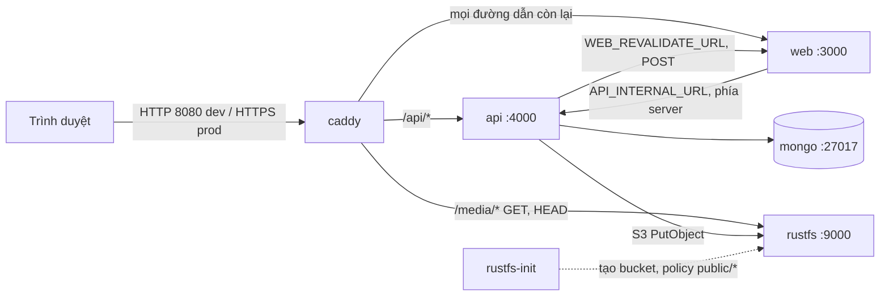
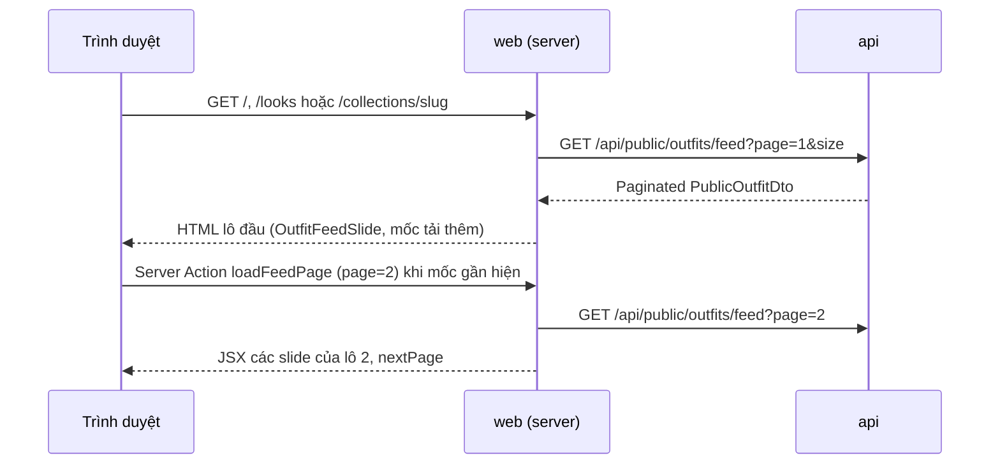
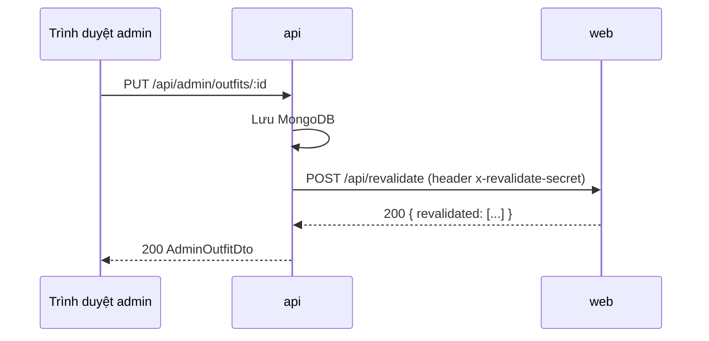
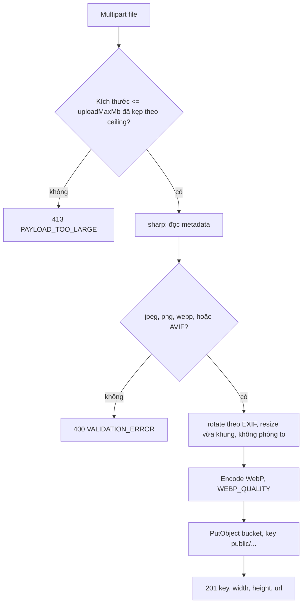

# Kiến trúc hệ thống Under30ss (v1)

Under30ss là trang lookbook "Shop the look": một ảnh người mẫu, các món đồ nối bằng đường chỉ tới từng món, bấm vào món để mở link affiliate. Dữ liệu outfit nằm trong MongoDB, ảnh nằm trong bucket S3 (RustFS). Next.js render trang public phía server để phục vụ SEO (`/`, `/looks`, `/look/[slug]`); Express API riêng phục vụ dữ liệu và khu quản trị `/admin`.

Tài liệu liên quan: [Quy chuẩn code](./code-standards.md) · [Triển khai](./deployment-guide.md) · [Lịch sử thay đổi](./project-changelog.md) · [Roadmap](./development-roadmap.md)

## Contents
- [Dịch vụ và cổng](#dịch-vụ-và-cổng)
- [Định tuyến Caddy](#định-tuyến-caddy)
- [Route web và giao diện](#route-web-và-giao-diện)
- [API đọc cho giao diện](#api-đọc-cho-giao-diện)
- [Mô hình dữ liệu](#mô-hình-dữ-liệu)
- [Bất biến featured](#bất-biến-featured)
- [Feed outfit](#feed-outfit)
- [Bản tin (newsletter)](#bản-tin-newsletter)
- [Luồng revalidate API → web](#luồng-revalidate-api--web)
- [Tuỳ chọn giao diện admin (cookie)](#tuỳ-chọn-giao-diện-admin-cookie)
- [Pipeline ảnh và media](#pipeline-ảnh-và-media)
- [Xác thực và giới hạn đăng nhập](#xác-thực-và-giới-hạn-đăng-nhập)
- [Lỗi, health check, cấu hình](#lỗi-health-check-cấu-hình)

## Dịch vụ và cổng

Stack chạy bằng `infra/docker-compose.yml` (dev, mặc định) và `infra/docker-compose.prod.yml` (override cho production). Compose đặt `name: under30ss`.

| Service | Image / build | Vai trò | Cổng trong mạng compose | Publish ra host |
|---------|---------------|---------|--------------------------|-----------------|
| `caddy` | `caddy:2.11.9` | Reverse proxy, định tuyến, body limit, HTTPS tự động (prod) | 80, 443 | dev: `CADDY_HTTP_PORT` (mặc định 8080) → 80; `CADDY_HTTPS_PORT` (mặc định 8443) → 443. prod: 80 và 443 |
| `web` | `apps/web/Dockerfile` (Next.js 16, output standalone) | Trang public (`/`, `/looks`, `/look/[slug]`), trang admin, `/api/revalidate` | 3000 | Không |
| `api` | `apps/api/Dockerfile` (Express 5, Node 24) | REST API `/api/*`, upload ảnh, session, rate limit | 4000 | Không |
| `mongo` | `mongo:8` | Dữ liệu outfit, admin, settings, session | 27017 | dev: `127.0.0.1:27017`. prod: không publish, bật auth |
| `rustfs` | `rustfs/rustfs:1.0.4` | Object storage tương thích S3 | 9000 (API S3), 9001 (console, không publish) | dev: `127.0.0.1:9000`. prod: không publish |
| `rustfs-permissions` | `alpine:3` | Chạy một lần: `chown` volume dữ liệu cho uid 10001 | — | Không |
| `rustfs-init` | `amazon/aws-cli:2.39.5` | Chạy một lần: tạo bucket, áp policy đọc công khai cho `public/*` | — | Không |

Volume đặt tên: `mongo-data`, `rustfs-data`, `caddy-data`, `caddy-config`. Lệnh `down -v` sẽ xoá các volume này (xem [Triển khai](./deployment-guide.md)).

Thứ tự khởi động (theo `depends_on`): `mongo`, `rustfs-permissions` → `rustfs` → `rustfs-init` (hoàn tất thành công). `api` chờ `mongo` healthy và `rustfs-init` hoàn tất. `web` chờ `api` healthy. `caddy` chờ `rustfs` đã start, `api` và `web` healthy.

## Sơ đồ thành phần



Lưu ý: trình duyệt chỉ gọi cùng origin. Admin gọi `/api/*` tương đối: qua Caddy ở compose/production, qua rewrite của `next dev` (chỉ bật khi `NODE_ENV=development`) khi chạy `pnpm dev` (xem [Triển khai, mục dev](./deployment-guide.md#chạy-local-để-phát-triển-pnpm-dev)).

## Định tuyến Caddy

Cấu hình nằm ở `infra/caddy/Caddyfile`. Thứ tự khối `handle` quan trọng: khối cụ thể nằm trước khối chung.

| Đường dẫn | Đích | Hành vi |
|-----------|------|---------|
| `/api/health*` | Không chuyển tiếp | Caddy trả 404 từ bên ngoài. Healthcheck của compose gọi thẳng `api:4000` |
| `/api/admin/media*` | `api:4000` | Body tối đa `UPLOAD_MAX_MB_CEILING` + 1 MiB (phần overhead multipart). Vượt quá trả 413 JSON `PAYLOAD_TOO_LARGE` |
| `/api/*` | `api:4000` | Chuyển tiếp nguyên trạng |
| `/media/*` | `rustfs:9000`, đường dẫn `/{S3_BUCKET}{path}` | Chỉ `GET` và `HEAD`; method khác trả 405 kèm `Allow: GET, HEAD`. Thêm `X-Content-Type-Options: nosniff`. Query string bị bỏ |
| còn lại | `web:3000` | Trang public, trang admin, asset Next.js |

Các cơ chế đã kiểm chứng khi chạy stack thật:
- Lỗi 413 luôn có `Content-Type: application/json; charset=utf-8` và body `{"error":{"code":"PAYLOAD_TOO_LARGE",...}}`. Thông điệp khớp hằng số `FILE_TOO_LARGE_MESSAGE` trong `apps/api/src/middleware/error-handler-middleware.ts`.
- Giới hạn body của Caddy được tính trong lệnh `command` của service `caddy` (`UPLOAD_BODY_MAX_MB=$$((UPLOAD_MAX_MB_CEILING + 1))`), vì placeholder của Caddyfile không tính số học được.
- Caddy bỏ qua `X-Forwarded-For` do client gửi (mặc định, vì client không thuộc `trusted_proxies`) và tự đặt IP thật. Limiter bản tin dựa vào cơ chế này, xem [Bản tin](#bản-tin-newsletter).
- Caddyfile chỉ khai báo `header_up Host` cho upstream web. Không có dòng nào đặt `X-Forwarded-Proto` tường minh (xem [cờ secure của cookie admin](#tuỳ-chọn-giao-diện-admin-cookie)).

## Route web và giao diện

Web dùng Next.js 16 App Router với hai route group, mỗi nhóm có layout riêng. Mã nguồn nằm trong `apps/web/src/app/`.

### Nhóm public: `app/(public)/`

| Đường dẫn | File | Vai trò |
|-----------|------|---------|
| `/` | `(public)/page.tsx` | Mặc định (`homeMode` không đặt hoặc `feed`): [feed outfit](#feed-outfit), outfit nổi bật đứng đầu. Khi `homeMode` = `sections`: trang dựng từ bố cục section (xem [Trang chủ và bộ sưu tập](#trang-chủ-và-bộ-sưu-tập)), có `h1` ẩn lấy tên SEO. Nhận query `?newsletter=` sau khi gửi form bản tin. Không có outfit nào thì hiện thông báo trống. `?page` vượt tổng số trang trả 404 |
| `/collections?page=n` | `(public)/collections/page.tsx` | Danh sách bộ sưu tập đã đăng (lưới, không đổi), phân trang theo `looksPageSize`. Tên trang lấy từ setting `collectionsLabel` |
| `/collections/[slug]` | `(public)/collections/[slug]/page.tsx` | [Feed outfit](#feed-outfit) lọc theo bộ sưu tập. Không còn ảnh bìa, mô tả hay breadcrumb hiển thị; tên bộ sưu tập là `h1` ẩn. Slug sai định dạng, không tồn tại hoặc chưa đăng trả 404. `?page=n` vượt tổng trả 404 |
| `/looks?page=n` | `(public)/looks/page.tsx` | [Feed outfit](#feed-outfit) toàn bộ outfit đã publish, nổi bật đứng đầu. `?page=n` bắt đầu từ lô n. `page` không hợp lệ được đưa về trang 1. `page` lớn hơn tổng số trang trả 404. Không có outfit nào thì hiện thông báo trống |
| `/look/[slug]` | `(public)/look/[slug]/page.tsx` | Một lookbook, breadcrumb về `/looks`, mục "Outfit khác" (loại outfit đang xem) |
| 404 | `(public)/not-found.tsx` | Dùng layout public có sẵn |
| (layout) | `(public)/layout.tsx` | Bọc `PublicShell`: header (ẩn khi cuộn xuống, hiện khi cuộn lên hoặc khi có focus) và footer |
| (chuyển trang) | `(public)/template.tsx` | Fade-in khi chuyển trang, bằng CSS (`fadeIn` trong `styles/motion-primitives.module.css`) |

`app/not-found.tsx` ở gốc xử lý URL không khớp route nào. Nó tự bọc `PublicShell`, vì không có layout nhóm `(public)` bao quanh.

Số outfit mỗi lô feed, mỗi trang `/collections` và số outfit "Outfit khác" lấy từ settings (`looksPageSize`, `relatedOutfitsCount`), xem [Settings](#settings).

### Nhóm admin: `app/admin/`

| Đường dẫn | File | Vai trò |
|-----------|------|---------|
| `/admin` | `admin/(protected)/page.tsx` | Tổng quan: số liệu, outfit nổi bật, outfit sửa gần đây. Có `q`, `status` hoặc `page` trên URL thì redirect 307 sang `/admin/outfits?...` |
| `/admin/outfits` | `admin/(protected)/outfits/page.tsx` | Danh sách outfit: lọc và phân trang phía server (`q`, `status`, `page`) |
| `/admin/outfits/new`, `/admin/outfits/[id]` | `outfits/new/page.tsx`, `outfits/[id]/page.tsx` | Tạo và sửa outfit |
| `/admin/settings` | `settings/page.tsx` | Cài đặt site, SEO, upload, số outfit mỗi trang, link Bộ sưu tập, footer, dải thông báo |
| `/admin/collections`, `/admin/collections/new`, `/admin/collections/[id]` | `collections/page.tsx`, `collections/new/page.tsx`, `collections/[id]/page.tsx` | Danh sách, tạo và sửa bộ sưu tập (ảnh bìa, outfit trong bộ sưu tập, Lên/Xuống, xoá) |
| `/admin/home` | `home/page.tsx` | Trình soạn trang chủ: thêm, sắp xếp, ẩn, sửa section; lưu nháp, đăng, hoàn tác |
| `/admin/home-preview` | `home-preview/page.tsx` | Xem trước bản nháp (ngoài nhóm `(protected)`, có banner "Bản xem trước, chưa đăng"). Không đổi những gì khách thấy |
| `/admin/newsletter` | `admin/(protected)/newsletter/page.tsx` | Danh sách người đăng ký, lọc theo email và trạng thái (phía server), xuất CSV, huỷ đăng ký, xoá vĩnh viễn |
| `/admin/users` | `users/page.tsx` | Danh sách, tạo và xoá admin |
| `/admin/login` | `admin/login/page.tsx` | Đăng nhập, nằm ngoài `(protected)` |
| 404 trong admin | `(protected)/not-found.tsx` | "Không tìm thấy trang", nút về `/admin/outfits` |

Các file trong `admin/`:

- `layout.tsx` (gốc admin): đọc cookie `admin-theme` và gắn `data-theme` lên phần tử gốc ngay trong HTML trả về, nên không nháy khi tải.
- `(protected)/layout.tsx`: kiểm tra đăng nhập, đọc cookie `admin-sidebar`, bọc `AdminToastProvider`, dựng khung gồm sidebar, topbar và `main#admin-main`. Dưới 1024px sidebar luôn là rail; dưới 768px là topbar kèm drawer.
- `loading.tsx` nằm ở `outfits/`, `outfits/[id]/`, `settings/` và `users/`. Không có `loading.tsx` ở `(protected)/`. Tổng quan dùng `Suspense` ngay trong `page.tsx`, vì loading boundary bọc quanh trang có redirect sẽ biến 307 thành 200 kèm meta refresh (lý do được ghi trong comment của `page.tsx`).
- `_lib/`: `admin-api.ts` (gọi API phía server, bọc `cache`), `admin-preferences.ts` (đọc cookie), `admin-preference-actions.ts` (Server Action ghi cookie).
- Mọi đường dẫn admin lấy từ `apps/web/src/lib/admin-paths.ts` (`ADMIN_PATHS`), không gõ tay.

## API đọc cho giao diện

Hai endpoint mới trong refactor giao diện. Hợp đồng nằm trong `packages/shared/src/api-contract.ts` và các file `*-contract.ts` cùng thư mục. Route nằm ở `apps/api/src/routes/`.

| Phương thức, đường dẫn | Quyền | Nội dung |
|------------------------|-------|----------|
| `GET /api/public/outfits?page&size` | Công khai | Trang outfit đã publish, mới nhất trước (`updatedAt` giảm dần, rồi `_id`). Mỗi phần tử gồm `slug`, `title`, `modelImage` (có `url`), `updatedAt`. Không lộ draft và link affiliate. `size` bỏ trống thì dùng `looksPageSize` của settings. `size` luôn kẹp về `PUBLIC_PAGE_SIZE_MAX`. `page` có trần kỹ thuật `MAX_LIST_PAGE` (100000). Tham số sai kiểu trả 400 |
| `GET /api/public/outfits/feed?page&size&collection` | Công khai | Dữ liệu đầy đủ cho [feed outfit](#feed-outfit): `Paginated<PublicOutfitDto>`. Nổi bật trước, rồi `updatedAt` giảm dần, rồi `_id`. Mỗi món có `affiliateUrl` và `anchor`; món không có `anchor` bị bỏ. `collection` là slug bộ sưu tập đã đăng; không có hoặc chưa đăng thì 404. `size` và trần như endpoint trên. `page` vượt tổng trả `items: []`, không 404. Tham số sai kiểu trả 400 |
| `GET /api/admin/stats` | Admin (sau `requireAdmin`) | `counts` gồm `total`, `published`, `draft`, `publishedMissingAffiliate`, `draftMissingAffiliate`; `featured` là outfit nổi bật đã publish hoặc `null`; `recent` gồm số outfit sửa gần đây theo `ADMIN_STATS_RECENT_COUNT` |

Ghi chú:
- "Thiếu link affiliate" đếm outfit có ít nhất một món với `affiliateUrl` rỗng. Không có bộ lọc riêng trong danh sách admin (quyết định trong plan).
- Danh sách public dùng index `{ status: 1, updatedAt: -1, _id: -1 }` (xem [Outfit](#outfit)).

## Mô hình dữ liệu

Các model Mongoose nằm trong `apps/api/src/models/`. Kiểu dữ liệu chia sẻ và quy tắc validate nằm trong `packages/shared/src/`.

### Outfit

| Trường | Kiểu | Ràng buộc |
|--------|------|-----------|
| `slug` | string | Duy nhất. Regex `^[a-z0-9]+(?:-[a-z0-9]+)*$`, tối đa 80 ký tự. Không được là `featured`, `slugs`, `feed` (`RESERVED_OUTFIT_SLUGS`, `outfitSlugSchema` trong `packages/shared/src/outfit-schemas.ts`) |
| `title` | string | 1–120 ký tự |
| `seoDescription` | string? | Tối đa 300 ký tự |
| `modelImage` | ImageRef | `{ key, width, height }`, key bắt đầu bằng `public/` |
| `status` | `draft` \| `published` | Có index đơn |
| `featured` | boolean | Tối đa một outfit `true` (xem [Bất biến featured](#bất-biến-featured)) |
| `items` | mảng, tối đa 30 | Mỗi món: `id`, `name` (1–80), `subtitle`?, `description`? (≤240), `image`, `side` (`left` \| `right`), `order`, `anchor`?, `affiliateUrl` (mặc định chuỗi rỗng) |
| `createdAt`, `updatedAt` | Date | Tự động (timestamps) |

Index của collection (`apps/api/src/models/outfit-model.ts`):

| Index | Mục đích |
|-------|----------|
| `{ featured: 1 }` unique, `partialFilterExpression: { featured: true }` | Một outfit nổi bật |
| `{ updatedAt: -1 }` | Sắp xếp theo thời gian sửa |
| `{ status: 1, updatedAt: -1, _id: -1 }` | Truy vấn danh sách public (`GET /api/public/outfits`) |
| `{ status: 1, featured: -1, updatedAt: -1, _id: -1 }` | Thứ tự feed (`GET /api/public/outfits/feed`) |

Index `{ status, updatedAt, _id }` được thêm trong refactor giao diện. API tạo index khi khởi động qua `ensureOutfitIndexes()` (`createIndexes`). Collection đã có dữ liệu thì chỉ cần khởi động lại API.

- `anchor` là `{ x, y }` với mỗi giá trị từ 0 đến 100 (tỉ lệ phần trăm trên ảnh người mẫu).
- `affiliateUrl` là chuỗi rỗng hoặc URL `https://`.
- Quy tắc publish: outfit `published` bắt buộc mọi món có `affiliateUrl` https và có `anchor`. Outfit `draft` được lưu dở dang.
- `id` của món phải duy nhất trong outfit.
- Public chỉ trả món có `anchor` (món không anchor không vẽ được lên lookbook).

### Admin user

Collection của model `AdminUser`. Trường: `email` (duy nhất, lowercase, trim), `passwordHash` (argon2id), `createdAt`, `updatedAt`. API chỉ có tạo, liệt kê và xoá admin. Không có endpoint đổi mật khẩu trong v1.

### Settings

Collection của model `Settings`, đúng một bản ghi với `singleton: 'site'`. Trường: `siteName`, `seoTitle`, `seoDescription`, `ogImage?` (`{ key, width, height }`, key phải thuộc `public/`), `uploadMaxMb?`, `looksPageSize?`, `relatedOutfitsCount?`, `homeMode?`, `updatedAt`.

- Khi chưa có bản ghi, API dùng giá trị từ env `DEFAULT_SITE_NAME`, `DEFAULT_SEO_TITLE`, `DEFAULT_SEO_DESCRIPTION`.
- `uploadMaxMb` nếu có được kẹp về `UPLOAD_MAX_MB_CEILING` khi đọc. Hạ trần sau này cũng siết giới hạn đã lưu trước đó.
- `looksPageSize` và `relatedOutfitsCount` không đặt thì dùng `PUBLIC_LOOKS_PAGE_SIZE` và `PUBLIC_RELATED_OUTFITS_COUNT`. Khi đọc được kẹp về `PUBLIC_PAGE_SIZE_MAX`. Khi ghi, giá trị vượt trần bị từ chối theo trường (`apps/api/src/services/settings-service.ts`).

### Session

Collection `sessions` do `connect-mongo` quản lý, TTL theo `SESSION_MAX_AGE_HOURS`.

## Bất biến featured

Tối đa một outfit được đặt nổi bật. Trang chủ `/` hiển thị outfit này đầu tiên trong feed (mặc định) hoặc trong section `FeaturedLookbook` (`homeMode` = `sections`). Feed và `/looks` luôn đưa outfit nổi bật lên đầu.

Cơ chế ba lớp:

1. **Index duy nhất một phần.** Index unique trên `featured` với `partialFilterExpression: { featured: true }` (xem `apps/api/src/models/outfit-model.ts`). Trên DB dev, code review ghi nhận tên index là `featured_1`.
2. **Build index khi khởi động, lỗi thì dừng.** `connectMongo` gọi `ensureOutfitIndexes()` (`apps/api/src/db/mongo-connection.ts`). Nếu build index thất bại (ví dụ DB đang có hai bản ghi `featured: true`), API ném lỗi và không khởi động. Không dựa vào `autoIndex` của Mongoose, vì lỗi build bị nuốt.
3. **Luồng ghi.** `applyFeatured` (`apps/api/src/services/outfit-service.ts`):
   - Đặt `featured: true` có điều kiện `{ _id, status: 'published' }`.
   - Nếu gặp lỗi trùng khoá (đã có outfit khác nổi bật), gỡ cờ ở các outfit khác rồi ghi lại.
   - Nếu lần ghi lại vẫn trùng (có request đồng thời), trả 409 `CONFLICT`.
   - Outfit `draft` không thể đặt nổi bật: trả 409 kèm `fields.featured`.
   - Chuyển outfit sang `draft` sẽ gỡ `featured` trong cùng lệnh cập nhật.
   - Seed chỉ đặt `featured` khi outfit được publish (`wantFeatured = featured && status === 'published'`).

Giới hạn đã biết: hai admin cùng bấm đặt nổi bật đồng thời thì một phía vẫn thấy trạng thái cũ trên editor tới khi tải lại trang. Dữ liệu vẫn đúng (chỉ một outfit nổi bật). Xem [Roadmap](./development-roadmap.md).

## Trang chủ và bộ sưu tập

### Mô hình dữ liệu

| Model | File | Nội dung |
|-------|------|----------|
| `Collection` | `apps/api/src/models/collection-model.ts` | `slug`, `name`, `description?`, `coverImage?`, `status` (`draft` / `published`), `order`, `seoDescription?`. Index `{ status, order, _id }` |
| `PageLayout` | `apps/api/src/models/page-layout-model.ts` | Collection `page_layouts`, `pageKey: 'home'` (`HOME_PAGE_KEY`). Giữ `draft`, `published`, `publishedAt`, và đúng một bản đăng trước (`previous`) |
| `Outfit.collectionIds` | `apps/api/src/models/outfit-model.ts` | Mảng id bộ sưu tập chứa outfit. Index `{ collectionIds, status, updatedAt, _id }` |

Bố cục trang chủ là JSON `[{ type, props: { id, visible, ... } }]` với `schemaVersion`. Mười một loại section: `HeroSlider`, `CollectionTiles`, `OutfitList`, `FeaturedLookbook`, `TextWithImage`, `Faq`, `Commitments`, `CampaignBanner`, `Marquee`, `Gallery`, `NewsletterSignup`. Schema nằm ở `packages/shared/src/home-sections/`, kiểu và union section ở `home-section-union.ts`; contract bố cục (nháp, đăng, hoàn tác, xem trước, section đã resolve) ở `packages/shared/src/home-layout-contract.ts`.

Bố cục chỉ hiện trên `/` khi `homeMode` = `sections`. Ở chế độ feed (mặc định) bố cục vẫn lưu và soạn như thường, khách không thấy. Trình soạn `/admin/home` hiện nhắc khi đang ở chế độ feed (`home-mode-notice.tsx`).

`HOME_SECTION_META` (`home-section-meta.ts`) mô tả từng loại cho trình soạn và trang xem trước, gồm hai cờ:
- `resolvesData`: API phải resolve dữ liệu cho loại này (outfit, bộ sưu tập, câu đồng ý).
- `hasImage`: loại này có ảnh tải lên, nên có thể giữ ảnh LCP của trang. `home-section-list.tsx` chọn section LCP theo cờ này.

### API

| Phương thức, đường dẫn | Quyền | Nội dung |
|------------------------|-------|----------|
| `GET /api/public/collections?page&size` | Công khai | Bộ sưu tập đã đăng, phân trang theo `looksPageSize` |
| `GET /api/public/collections/slugs` | Công khai | Slug và `updatedAt` cho sitemap |
| `GET /api/public/collections/:slug` | Công khai | Một bộ sưu tập kèm outfit đã đăng, mới nhất trước. Không có hoặc chưa đăng: 404 |
| `GET /api/public/home` | Công khai | Các section đã resolve từ bản đăng; chưa đăng thì trả bố cục mặc định (`DEFAULT_HOME_CONTENT`, năm section). Section lỗi dữ liệu bị lọc khỏi danh sách |
| `GET/POST /api/admin/collections`, `GET/PUT/DELETE /api/admin/collections/:id` | Admin | CRUD. Đăng (`published`) bắt buộc có ảnh bìa |
| `POST /api/admin/collections/:id/move` | Admin | `{ direction: 'up' | 'down' }`, đổi `order` |
| `POST/DELETE /api/admin/collections/:id/outfits[/:outfitId]` | Admin | Gán và gỡ outfit. Gán theo kiểu tất cả hoặc không: giới hạn `MAX_COLLECTIONS_PER_OUTFIT` = 24 bộ sưu tập mỗi outfit. Có outfit đã đủ 24 bộ sưu tập thì trả 400 `VALIDATION_ERROR` (`fields.outfitIds`), không thêm outfit nào. Nếu bộ sưu tập bị xoá giữa chừng thì gỡ id vừa thêm và trả 404 |
| `GET /api/admin/home` | Admin | Bản nháp, bản đăng, `publishedAt`, `previous`, `hasUnpublishedChanges`, `usingDefault` |
| `PUT /api/admin/home/draft` | Admin | `{ content, baseUpdatedAt }`. Sai `baseUpdatedAt` trả 409. Không revalidate |
| `POST /api/admin/home/preview` | Admin | Resolve một bố cục gửi lên, không lưu. `GET /home/preview` resolve bản nháp đã lưu |
| `POST /api/admin/home/revert-draft` | Admin | Bản nháp quay về bản đăng. Không revalidate |
| `POST /api/admin/home/publish` | Admin | `{ baseUpdatedAt }`. Bản đăng cũ thành `previous`, revalidate `/`. Nháp trùng bản đang đăng thì không ghi gì: trả 200 với `publishedAt` và `previous` hiện tại, không revalidate (an toàn khi client gọi lại hoặc mở tab thứ hai). Nháp quá cũ (`baseUpdatedAt` lệch) vẫn trả 409 |
| `POST /api/admin/home/restore-previous` | Admin | `{ basePublishedAt }`. Đổi chỗ bản đăng và `previous` (làm lại lần nữa là quay về bản vừa đăng). Có lock theo `basePublishedAt`. Không có bản đăng trước: 409 với `fields.previous = 'NO_PREVIOUS'`. Revalidate `/` |
| `POST /api/admin/home/reset` | Admin | Bản nháp về mặc định, bản đăng cũ giữ làm `previous` nếu đã có đăng. Revalidate `/` |

Route nằm ở `apps/api/src/routes/admin-home-routes.ts`, `public-home-routes.ts`, `admin-collection-routes.ts`, `public-collection-routes.ts`. Logic đăng và hoàn tác ở `apps/api/src/services/home-layout-publish-service.ts`.

### Luồng nháp → đăng → hoàn tác

1. Trình soạn lưu nháp (`PUT /draft`). Khách chưa thấy gì.
2. Xem trước bằng `/admin/home-preview` (đọc nháp, không ghi).
3. "Đăng" (`POST /publish`): bản đăng hiện tại chuyển thành `previous`, nháp thành bản đăng. Không hỏi xác nhận; toast có nút "Hoàn tác" (giữ 10 giây, dừng khi rê chuột hoặc focus).
4. "Hoàn tác" (toast hoặc menu "Khác" → "Hoàn tác lần đăng gần nhất") gọi `restore-previous`. Chỉ giữ một bản trước, nên hoàn tác hai lần là quay về bản vừa đăng.
5. "Khôi phục bố cục mặc định" (`reset`) xoá bản nháp, hỏi xác nhận. Bản đăng cũ vẫn hoàn tác được.

### Revalidate theo tag

Ngoài đường dẫn, contract revalidate có `tags` (chỉ nhận tag khai báo trong `PUBLIC_CACHE_TAGS`, `packages/shared/src/revalidate-contract.ts`). `scope: 'all'` expire mọi tag. Web gọi `revalidateTag(tag, { expire: 0 })` (`apps/web/src/app/api/revalidate/route.ts`), theo [tài liệu Next.js](https://nextjs.org/docs/app/api-reference/functions/revalidateTag). Dưới `next dev`, request đầu tiên sau khi đăng có thể còn nội dung cũ; production (`next build` + `next start`) đã kiểm chứng đọc mới.

| Sự kiện | Đường dẫn | Tag |
|---------|-----------|-----|
| Đổi bộ sưu tập | đường dẫn bộ sưu tập (`collectionPaths`, `revalidate-web-service.ts:39`) | `public-collections`, `public-home`, `public-settings` |
| Đổi outfit | đường dẫn outfit (`outfitPaths`, `revalidate-web-service.ts:35`) | `public-collections`, `public-home` |
| Đăng, hoàn tác, reset bố cục | `/` | `public-home` (`HOME_REVALIDATION`, `revalidate-web-service.ts`) |

Tag `public-home` gắn vào fetch bố cục trong `apps/web/src/lib/seo/public-home-loaders.ts`; `public-collections` gắn vào loader bộ sưu tập.

### Settings bổ sung

Các trường mới của `Settings` (đều optional, API luôn điền khi đọc):

- `collectionsNavEnabled`: mặc định bật. Link "Bộ sưu tập" trên header và footer chỉ hiện khi có ít nhất một bộ sưu tập đã đăng.
- `collectionsLabel`: tên hiển thị của link và trang bộ sưu tập, mặc định `DEFAULT_COLLECTIONS_LABEL`.
- `footer`: `{ columns: [{ title, links: [{ label, href }] }], social: [{ label, href }] }`. Tối đa 4 cột, 8 link mỗi cột, 8 link mạng xã hội. `href` nội bộ (`/...`) hoặc `https://`; link `javascript:` bị từ chối (schema `safeHrefSchema`, `packages/shared/src/safe-href.ts`; e2e kiểm tra tại ô nhập).
- `announcement`: `{ enabled, text (≤160), linkLabel? (≤40), href? }`, mặc định tắt. Là cấu hình toàn site, hiện phía trên header public, không phải section trang chủ.
- `homeMode`: `'feed'` hoặc `'sections'`. Không đặt thì là `feed` (`DEFAULT_HOME_MODE` trong `packages/shared/src/settings-schemas.ts`). Chỉ quyết định `/`: `feed` hiện [feed outfit](#feed-outfit), `sections` hiện bố cục section. Trả về trong settings công khai và settings admin (`settings-service.ts`). Admin đặt ở Cài đặt, mục "Danh sách", ô "Trang chủ hiển thị".
- `newsletterConsent` và `newsletterConsentVersion`: câu đồng ý cạnh ô chọn của form bản tin. Chi tiết ở [Bản tin](#bản-tin-newsletter).

Settings là PUT toàn bộ document: client phải gửi lại mọi trường, trường bị bỏ sẽ bị xoá (xem `e2e/support/admin-settings.ts`). `newsletterConsentVersion` là ngoại lệ: không bị xoá khi bỏ câu đồng ý.

### Section editorial và section mới

| Section | Resolve ở API | Ghi chú |
|---------|---------------|---------|
| `CampaignBanner` | Không (`attachSectionImageUrls`) | Một ảnh lớn kèm khung chữ nền đặc và nút. Ảnh đi qua `listSectionImageKeys` → `isPublicKey` như mọi ảnh section |
| `Marquee` | Không | Một dòng chữ chạy ngang bằng CSS. Không có dữ liệu |
| `Gallery` | Có (`home-section-gallery-resolver.ts`) | `source`: `latest` (mặc định), `collection` hoặc `manual`. Ô ảnh link tới `/look/<slug>`. Số ô tối đa theo `MAX_GALLERY_ITEMS` và `PUBLIC_PAGE_SIZE_MAX`; có bao nhiêu outfit thực thì hiện bấy nhiêu. Không có outfit nào thì cả section bị bỏ |
| `NewsletterSignup` | Có (câu đồng ý đã lưu) | Không có câu đồng ý đã lưu thì section bị bỏ khỏi kết quả |

Trên một trang, `Gallery` nguồn `latest` bỏ các outfit đã hiện ở `OutfitList` và `FeaturedLookbook` của cùng trang (`shownOutfitSlugs` trong `home-section-resolver-service.ts`), và lấy thêm để đủ số ô. Nguồn `collection` và `manual` hiện chưa bỏ trùng.

Bố cục mặc định (`DEFAULT_HOME_CONTENT`, `packages/shared/src/home-sections/default-home-content.ts`) gồm năm section: `FeaturedLookbook`, `CollectionTiles`, `OutfitList`, `Gallery`, `NewsletterSignup`. Bố cục đã đăng trước đó không đổi khi mặc định thay đổi.

## Feed outfit

Trang `/` (khi `homeMode` là `feed`), `/looks` và `/collections/[slug]` hiển thị outfit dạng feed: mỗi khung là một bài Photo vừa màn hình, người dùng lướt dọc và vuốt ngang qua các ảnh của outfit. Plan: `plans/261110-2143-tiktok-outfit-feed/` (khung feed) và `plans/261112-0854-tiktok-photo-post-feed/` (bài Photo).

### Luồng dữ liệu và render



- Lô đầu render trên server (có nội dung khi tắt JS và cho SEO). `?page=N` bắt đầu thẳng từ lô N.
- Mốc tải thêm là `<a href="?page=N+1">`. `FeedLoadMore` (client) theo dõi mốc bằng `IntersectionObserver` trên vùng cuộn `[data-feed]`, với `rootMargin` lấy từ `--feed-preload-margin` (150%). Khi JS chạy, bấm mốc gọi Server Action thay vì chuyển trang.
- Server Action `loadFeedPage` (`apps/web/src/lib/feed/load-feed-page-action.tsx`) kiểm input bằng `publicOutfitFeedQuerySchema`, gọi loader, trả slide đã render và `nextPage`. Lỗi thì hiện nút thử lại.
- Hết outfit (`nextPage` = null): feed render `SiteFooter` ở cuối. Shell ẩn footer riêng khi có feed.
- Các file chính trong `apps/web/src/components/feed/`: `outfit-feed.tsx` (server), `outfit-feed-slide.tsx` (server, khung một outfit), `feed-load-more.tsx` (client), `feed-step-buttons.tsx` (client, nút ▲▼ và phím ↑ ↓ PageUp PageDown, ← → cho ảnh). Các phần của bài Photo nằm ở mục [Bài Photo trong khung](#bài-photo-trong-khung). Tokens `--feed-*` nằm trong `apps/web/src/styles/design-tokens.css`.

### Điều hướng và bố cục khung

- Shell có feed: `.shell:has([data-feed-wrap])` cao đúng `100dvh`, feed là vùng cuộn riêng, scroll-snap theo từng khung (`public-shell.module.css`, `outfit-feed.module.css`).
- Nút ▲▼ hiện từ 768px trở lên (`.steps` trong `outfit-feed.module.css`). Phím mũi tên, PageUp và PageDown hoạt động khi focus không nằm trong ô nhập. Phím ← → đổi ảnh trong outfit đang hiện, không đổi outfit.
- Dưới 768px, header thành một dòng (`site-header.module.css`, chỉ khi có feed). Nav cuộn ngang trong header trên các trang feed.
- Lookbook chế độ `fill` (`apps/web/src/components/lookbook/lookbook-fill.module.css`), chỉ bằng CSS:

| Quy tắc | Điều kiện | Ghi chú |
|---------|-----------|---------|
| Người mẫu cao đúng khung, ảnh món co theo phần cột | Luôn | Chữ giữ cỡ, không co đều theo khung |
| Mô tả món giới hạn 2 dòng | Luôn | `--feed-item-description-lines` |
| Ẩn mô tả món | Một cột có từ 5 món trở lên | Selector `:has([data-side] > li:nth-child(5))` |
| Ẩn phụ đề | Vùng chứa lookbook từ 520px trở xuống | `@container (max-height: 520px)`, không tính dòng tên outfit |

- Tên outfit trong khối chữ góc dưới trái là link tới `/look/[slug]`. Bấm món đồ trong lookbook đi thẳng link affiliate (hành vi lookbook không đổi).
- Số outfit mỗi lô là `looksPageSize`. Trần là `PUBLIC_PAGE_SIZE_MAX`.

### Bài Photo trong khung

Mỗi outfit là một `<article data-feed-slide>` nền đen. Dải ảnh là `ul[data-photo-track]` cuộn ngang, `scroll-snap-type: x mandatory`. Dữ liệu lấy từ `PublicOutfitDto` có sẵn (`modelImage`, `items[].image`, `items[].affiliateUrl`), không đổi API.

```text
OutfitFeedSlide (article, server)
├── FeedPhotoTrack (ul, server)      tấm 1 lookbook · tấm 2 người mẫu · tấm 3+ mỗi món (FeedItemPhoto)
├── FeedPostCaption (server)         tên outfit (link) + seoDescription, 2 dòng
├── FeedPhotoNav (client)            chấm, hoặc "i/n" khi quá 10 tấm; mũi tên từ 768px
└── FeedActionRail (server)
    ├── FeedShopSheet (client)       "Mua đồ" mở <dialog> danh sách món
    └── FeedShareButton (client)     "Chia sẻ": navigator.share → clipboard
```

| Hành vi | Quy tắc | Nơi xử lý |
|---------|---------|-----------|
| Thứ tự tấm | Tấm 1 lookbook (chừa đáy bằng `--feed-post-band-height` để chữ không che link món). Tấm 2 ảnh người mẫu, `contain`. Tấm 3+ theo thứ tự `items` của DTO | `feed-photo-track.tsx`, `feed-item-photo.tsx`, `feed-post.module.css` |
| Chấm và bộ đếm | Chấm có vùng chạm `--feed-dot-hit-size` (24px). Quá 10 tấm (`MAX_DOTS`) thì hiện "i/n" | `feed-photo-nav.tsx` |
| Mũi tên | Ẩn dưới 768px. Từ 1024px nằm ngoài ảnh, cùng cột nút | `feed-post-controls.module.css` |
| Link mua | Qua `affiliateLinkProps`. URL xấu thành `aria-disabled` với `tabIndex: -1` | `lookbook-link-props.ts` |
| Chia sẻ | `navigator.share({ title, url })`. Huỷ (AbortError) thì im lặng. Lỗi khác hoặc không có API thì chép link và báo qua `role="status"` trong `--feed-share-status-duration` | `feed-share-button.tsx` |
| Link chia sẻ | `new URL(outfitPath, window.location.origin)`, không lấy `SITE_URL` (lệch có chủ ý, đã chốt 2026-11-12) | `feed-share-button.tsx` |
| Phím | ← → đổi tấm của slide đang hiện. Bỏ qua khi target nằm trong ô nhập hoặc `dialog` | `feed-step-buttons.tsx` |
| Tắt JS | Dải ảnh vẫn cuộn ngang, link outfit vẫn bấm được. Nút Mua đồ, Chia sẻ, chấm và mũi tên ẩn bằng `@media (scripting: none)` | `feed-post-controls.module.css` |

- Sheet "Mua đồ" dùng `<dialog>` gốc qua `useModalDialog`: Esc, nút Đóng hoặc bấm nền ngoài để đóng; đóng xong focus trả về nút "Mua đồ".
- Token của bài Photo: `--feed-post-*`, `--feed-rail-*`, `--feed-dot-*`, `--feed-sheet-*`, `--feed-photo-arrow-size`, `--feed-share-status-duration` trong `design-tokens.css`.

### Giới hạn đã biết

- `/` không trả 404 khi `?page` vượt tổng số trang. Hai trang còn lại trả 404.
- Thứ tự feed (`featured`, `updatedAt`) chưa có index riêng. API sắp xếp trên bộ nhớ. Chưa đo ở quy mô lớn.
- Thu khung chỉ bằng CSS. Không có tính toán chiều rộng bằng JS.

## Bản tin (newsletter)

Form đăng ký nhận tin là section `NewsletterSignup` trên trang chủ. Hệ thống chỉ dùng single opt-in: khách đăng ký là có tên trong danh sách, không có email xác nhận. Double opt-in để sau, xem [Roadmap](./development-roadmap.md).

### Mô hình dữ liệu

| Model | File | Nội dung |
|-------|------|----------|
| `NewsletterSubscriber` | `apps/api/src/models/newsletter-subscriber-model.ts` | Collection `newsletter_subscribers`. `email` duy nhất, lowercase. `status`: `subscribed` hoặc `unsubscribed`. Giữ `consentedAt`, `consentText`, `consentTextVersion`, `source` (hiện chỉ `home`), `unsubscribedAt?`, và `events` |

- `events` là lịch sử chỉ thêm: `subscribe` hoặc `unsubscribe`, `actor` là `self` hoặc `admin`, kèm `at`, `textVersion?`, `consentText?`. `consentText` là bản chụp câu đồng ý khách đã tick, dùng làm bằng chứng.
- Không lưu IP của khách. IP chỉ dùng trong bộ nhớ của limiter.
- Đăng ký lại sau khi huỷ: bản ghi chuyển về `subscribed`, các event cũ được giữ.

Câu đồng ý (`Settings`):
- `newsletterConsent` là `{ text, privacyHref?, privacyLabel }`. `newsletterConsentVersion` là số nguyên tăng dần, bắt đầu từ 1.
- Version tăng khi đổi `text` hoặc `privacyHref`. Chỉ đổi `privacyLabel` thì không tăng. Việc tăng dùng một lệnh cập nhật có điều kiện (`saveConsent`, `apps/api/src/services/settings-newsletter-consent-service.ts`), nên hai lần lưu đồng thời cùng nội dung chỉ tăng một lần.
- Chưa có câu đồng ý đã lưu thì `toSavedConsent` trả `null`. Form không hiện, dù section đã có trong bố cục. Tắt công tắc "Hiện form đăng ký trên trang chủ" trong Cài đặt cũng làm form ẩn.

### Luồng gửi form

1. Khách tick ô đồng ý và bấm đăng ký. Form gửi tới Server Action `subscribeNewsletter` (`apps/web/src/lib/newsletter/subscribe-newsletter-action.ts`). Form gửi được khi tắt JS.
2. Action lấy IP khách từ `X-Forwarded-For`, lấy phần tử cuối (`pickClientIp`, `newsletter-client-ip.ts`). Phần tử cuối là IP mà Caddy đã thấy, khách không tự đặt được. Action gọi `POST /api/public/newsletter` kèm header đó.
3. API xử lý theo thứ tự: giới hạn tần suất, kiểm body (`newsletterSubscribeRequestSchema`, trong đó `consent` phải là `true`), honeypot (trường `website`), kiểm `consentTextVersion` khớp câu đang lưu, rồi ghi bản ghi.
4. Action redirect về `/?newsletter=<kết quả>` kèm neo tới section (PRG). Trang đọc query và hiện thông báo, không cần JS.

| Phản hồi API | `?newsletter=` | Ghi chú |
|--------------|----------------|---------|
| 202 `{ ok: true }` | `ok` | Gồm email mới, email đã có và honeypot. API không lộ email nào đã có trong danh sách |
| 400 | `invalid` | Email sai hoặc chưa tick ô đồng ý |
| 409 | `stale` | `consentTextVersion` lệch: câu đồng ý đã đổi. Action gọi `revalidateTag('public-home', { expire: 0 })` để lần tải sau thấy câu mới |
| 429 | `rate` | Vượt giới hạn tần suất |
| Khác | `error` | Log không ghi email hay IP |

Honeypot: action trả `ok` ngay, không gọi API. Email không được ghi vào log.

### Giới hạn tần suất

- `createNewsletterRateLimit` (`apps/api/src/middleware/newsletter-rate-limit-middleware.ts`) dùng `express-rate-limit`, bộ đếm nằm trong RAM của API. Khởi động lại API thì bộ đếm mất.
- Cửa sổ `NEWSLETTER_RATE_LIMIT_WINDOW_MINUTES` (mặc định 15) và ngưỡng `NEWSLETTER_RATE_LIMIT_MAX_PER_IP` (mặc định 10). Đọc ở `apps/api/src/lib/runtime-defaults.ts`.
- Đếm mọi request, kể cả 400 và 409, để bot không dò được email miễn phí. Header `RateLimit` theo draft-8.
- Khoá theo IP chỉ đúng khi `trust proxy` đang bật. Code bật `trust proxy` (1 bước) chỉ khi `NODE_ENV=production` (`apps/api/src/create-app.ts`). Ngoài production, web gọi API trực tiếp nên mọi khách chung một bộ đếm. Hướng dẫn staging và CDN: [Triển khai](./deployment-guide.md).
- API không publish cổng ra ngoài trong compose, nên không ai gọi thẳng API được để giả `X-Forwarded-For`.

### Quản trị

Trang `/admin/newsletter` đọc danh sách phía server. Các route nằm sau `requireAdmin` (`apps/api/src/create-app.ts`).

| Phương thức, đường dẫn | Nội dung |
|------------------------|----------|
| `GET /api/admin/newsletter?q&status&page&size` | Một trang danh sách, lọc theo email (`q`) và trạng thái (`status`). `size` mặc định lấy từ `ADMIN_PAGE_SIZE_*` |
| `GET /api/admin/newsletter/export` | CSV, stream theo cursor, `Cache-Control: no-store`. Dùng cùng bộ lọc với danh sách |
| `PATCH /api/admin/newsletter/:id/unsubscribe` | Huỷ đăng ký. Giữ bản ghi, đổi `status` thành `unsubscribed` và ghi event `unsubscribe` với `actor: admin` |
| `DELETE /api/admin/newsletter/:id` | Xoá cứng, trả 204. Mất cả lịch sử đồng ý của email đó |

Huỷ đăng ký là thao tác mặc định. Xoá cứng phải xác nhận trong hộp thoại.

Định dạng CSV (`apps/api/src/services/newsletter-csv-export.ts`):
- Có BOM UTF-8 để Excel đọc đúng tiếng Việt. Xuống dòng CRLF. Mọi ô nằm trong dấu nháy kép.
- Ô bắt đầu bằng `=`, `+`, `-`, `@`, tab hoặc CR được thêm dấu `'` phía trước, để chặn công thức (CSV injection).
- Các cột: Email, Trạng thái, Ngày đăng ký, Cập nhật, Nguồn, Phiên bản câu đồng ý, Lịch sử (các event, nối bằng `; `).

## Luồng revalidate API → web

Trang public của web được cache. Khi admin thay đổi dữ liệu, API báo web làm mới cache ngay.



Chi tiết:

| Sự kiện (API) | Body gửi tới web | Web làm gì |
|---------------|------------------|------------|
| Tạo, sửa, xoá, đặt nổi bật outfit | `{ paths: ['/', '/looks', '/look/<slug>', '/sitemap.xml'] }`. Khi đổi slug thêm `/look/<slug cũ>` | `revalidatePath` từng đường dẫn |
| Lưu settings | `{ scope: 'all' }` | `revalidatePath('/', 'layout')` và `revalidateTag('public-settings', { expire: 0 })` (`apps/web/src/app/api/revalidate/route.ts`) |
| Seed mẫu | Đường dẫn của các slug vừa seed | Như trên |

- Đường dẫn `/looks` do `outfitPaths` (`apps/api/src/services/revalidate-web-service.ts`) thêm vào mọi lần đổi outfit, dùng hằng `LOOKS_PAGE_PATH` trong `packages/shared`.
- Tag `public-settings` (`PUBLIC_SETTINGS_CACHE_TAG`) được gắn vào fetch settings trong `apps/web/src/lib/seo/public-data-loaders.ts`.
- Header bắt buộc: `x-revalidate-secret` (hằng `REVALIDATE_SECRET_HEADER` trong `packages/shared`). Web so sánh bằng SHA-256 + `timingSafeEqual`; sai thì trả 401.
- Body được validate bằng `revalidateRequestSchema`: tối đa 50 đường dẫn, không trùng, mỗi đường dẫn bắt đầu bằng `/`, hoặc `{ scope: "all" }`.
- API chờ gọi revalidate với timeout 3 giây. Nếu web lỗi hoặc chậm, API chỉ ghi log cảnh báo `[revalidate]`, request admin vẫn thành công.
- Lưới an toàn: các loader public dùng `revalidate: PUBLIC_REVALIDATE_SECONDS` (mặc định 300). Nếu một lần revalidate bị mất, trang tối đa cũ thêm chừng đó giây.
- Đường `/api/revalidate` nằm trên web nhưng Caddy không chuyển `/api/*` của web ra ngoài (các `/api/*` đều tới API), nên chỉ mạng nội bộ compose gọi được.

Giới hạn về `/looks` và settings:
- `/`, `/looks` và `/collections/[slug]` đọc feed (`getOutfitFeedPage`, `apps/web/src/lib/seo/public-feed-loaders.ts`) gắn tag `public-home` và `public-collections`. Đổi outfit hoặc bộ sưu tập làm mới các trang này ngay. Lưu settings (`scope: 'all'`) expire mọi tag. Chưa đo độ trễ sau khi đổi `looksPageSize`.
- Mục "Outfit khác" trên `/look/<slug>` có thể cũ tới `PUBLIC_REVALIDATE_SECONDS` khi outfit khác đổi. Đây là chấp nhận có chủ đích (quyết định 8 trong plan).

## Tuỳ chọn giao diện admin (cookie)

Hai cookie lưu tuỳ chọn hiển thị của admin. Không chứa dữ liệu nhạy cảm.

| Cookie | Giá trị hợp lệ | Mặc định (khi thiếu hoặc sai) | Ý nghĩa |
|--------|----------------|-------------------------------|---------|
| `admin-theme` | `light`, `dark`, `system` | `system` | Giao diện sáng, tối, hoặc theo hệ điều hành |
| `admin-sidebar` | `expanded`, `rail` | `expanded` | Sidebar đầy đủ hoặc thu gọn thành rail icon. Dưới 1024px bị ép thành rail, không đọc giá trị này |

Cách ghi và đọc (`apps/web/src/app/admin/_lib/`):

- Ghi qua Server Action `setAdminTheme` và `setSidebarState` (`admin-preference-actions.ts`), nhận `FormData`. Vì là form submit nên chạy được khi tắt JS. Giá trị ngoài danh sách bị bỏ qua, cookie giữ nguyên.
- Đọc qua `readAdminTheme` và `readSidebarState`, có `safeParse`. Giá trị lạ trả về mặc định.
- Thuộc tính: `httpOnly`, `sameSite: lax`, `path: /admin`, `maxAge` một năm (`PREFERENCE_MAX_AGE_SECONDS`).
- Cờ `secure` chỉ bật khi request có header `x-forwarded-proto: https`. Không suy từ `NODE_ENV`, vì compose chạy build production qua HTTP. Chưa kiểm chứng: Caddy có tự gửi header này tới web hay không. Xem [Roadmap, việc chưa kiểm chứng](./development-roadmap.md#việc-chưa-kiểm-chứng).
- Theme được gắn lên HTML trả về từ server (`data-theme`), nên trang tải đúng theme ngay lần đầu.

## Pipeline ảnh và media

Upload: `POST /api/admin/media?kind=model|item` với multipart, field `file`. Chỉ `admin` được gọi.



- Giới hạn pixel đầu vào 100 triệu (chống decompression bomb, là guard kỹ thuật).
- Cạnh lớn nhất: `IMAGE_MAX_EDGE_MODEL` (1600) cho ảnh `model`, `IMAGE_MAX_EDGE_ITEM` (800) cho ảnh `item`. Ảnh nhỏ hơn không bị phóng to.
- Metadata (EXIF) được bỏ khi encode lại. Alpha được giữ.
- Key: `public/{model|item}/{yyyy}/{mm}/{uuid}.webp`. Seed dùng key theo nội dung: `public/{kind}/seed/{sha256 24 ký tự}.webp`, nên chạy seed lại không tạo object trùng.
- Header lưu trữ: `Content-Type: image/webp`, `Cache-Control: public, max-age=31536000, immutable` (mỗi upload có key mới nên cache lâu là an toàn).
- URL công khai: `MEDIA_PUBLIC_BASE_URL` ghép với key (`buildMediaUrl`). Ví dụ `http://localhost:8080/media/public/item/2026/11/<uuid>.webp`.
- Đọc ẩn danh: `rustfs-init` áp policy `s3:GetObject` cho `arn:aws:s3:::<bucket>/public/*`. Object ngoài `public/` không đọc được qua `/media`.
- Ghi: chỉ API có `S3_ACCESS_KEY` và `S3_SECRET_KEY`. Caddy chặn mọi method ghi tới `/media`.
- Mọi key đưa vào outfit hoặc `settings.ogImage` phải bắt đầu bằng `public/`, nếu không API trả 400.

Đã biết:
- Xoá outfit hoặc thay ảnh không xoá object cũ trong bucket. Chưa có tiến trình dọn dẹp (mục L8 trong [Roadmap](./development-roadmap.md)).
- `next/image` chạy `unoptimized: true`. Ảnh người mẫu 1600px tải nguyên bản trên mobile.

## Xác thực và giới hạn đăng nhập

### Phiên admin

- `express-session` với cookie `u30.sid`: `httpOnly`, `sameSite: lax`, `secure` theo `SESSION_COOKIE_SECURE`, `maxAge` theo `SESSION_MAX_AGE_HOURS`.
- Đăng nhập thành công: đổi session id (chống session fixation), rồi lưu `adminId` vào session.
- Đăng xuất: huỷ session và xoá cookie `u30.sid`.
- `requireAdmin` kiểm tra admin còn tồn tại trong DB ở mỗi request, nên xoá admin là mất quyền ngay.
- Cờ `secure` của cookie: nếu `SESSION_COOKIE_SECURE` không đặt thì bật khi `NODE_ENV=production`. Compose dev đặt `false` (HTTP). Compose prod đặt `true`. Chạy HTTP mà cookie `secure` thì đăng nhập không giữ được.

### Mật khẩu

- Băm bằng argon2id.
- Semaphore giới hạn số phép băm/so sánh chạy đồng thời (`ARGON2_MAX_CONCURRENCY`, mặc định 2). Hàng đợi chờ tối đa `ARGON2_MAX_QUEUE` (mặc định 20). Vượt hàng đợi trả 503 kèm thông điệp "hệ thống đang bận".
- Email không tồn tại vẫn chạy một phép verify với hash giả để thời gian phản hồi không lộ email có tồn tại hay không. Hash giả được tạo sẵn khi khởi động.

### Ba limiter đăng nhập

Cả ba đều phải qua. Cửa sổ thời gian `LOGIN_RATE_LIMIT_WINDOW_MINUTES` (mặc định 15). Bộ nhớ lưu trong tiến trình API, nên restart API sẽ xoá bộ đếm.

| # | Khoá | Đếm | Ngưỡng (env, mặc định) | Ghi chú |
|---|------|-----|------------------------|---------|
| 1 | IP | Mọi lần thử | `LOGIN_RATE_LIMIT_MAX_ATTEMPTS_PER_IP` (20) | Chặn một IP thử nhiều email |
| 2 | IP + email | Chỉ lần sai | `LOGIN_RATE_LIMIT_MAX_FAILURES` (5) | Chặn đoán mật khẩu một tài khoản từ một địa chỉ. Bỏ qua khi không có email hợp lệ |
| 3 | Email (mọi IP) | Chỉ lần sai | `LOGIN_RATE_LIMIT_MAX_FAILURES_PER_EMAIL` (50) | Lưới an toàn cho tấn công phân tán. Bỏ qua khi trình duyệt có cookie thiết bị hợp lệ cho đúng email đó |

- Lần sai được tính là phản hồi 4xx, trừ 429 (do limiter khác chặn) và 5xx (hàng đợi argon2 đầy). Như vậy các phản hồi không tiết lộ thông tin về mật khẩu không tiêu hao hạn mức.
- Email được chuẩn hoá (trim, lowercase) trước khi làm khoá.

### Cookie thiết bị `u30.dev`

- Được đặt sau mỗi lần đăng nhập thành công.
- Giá trị là HMAC-SHA256 của `device-cookie:<email đã chuẩn hoá>` với khoá `SESSION_SECRET`. Chỉ chứng minh trình duyệt này đã đăng nhập thành công bằng email đó.
- `httpOnly`, `sameSite: lax`, `secure` theo `SESSION_COOKIE_SECURE`, `maxAge` theo `LOGIN_DEVICE_COOKIE_MAX_AGE_DAYS` (mặc định 90 ngày).
- Mục đích: admin đã đăng nhập từ thiết bị đó không bị khoá bởi limiter 3 do kẻ khác cố tình gây sai. Limiter 1 và 2 vẫn áp dụng cho thiết bị đó.
- Đăng xuất không xoá cookie `u30.dev` (đúng với code hiện tại).
- Sau khi rebuild lên phiên bản có cookie này, admin phải đăng nhập lại một lần để nhận cookie.

### Các lớp bảo vệ khác

- `helmet` cho header bảo mật.
- Kiểm `Origin` cho mọi method ghi (không phải GET, HEAD, OPTIONS). Origin không nằm trong `ALLOWED_ORIGIN` (danh sách, phân tách bằng dấu phẩy) trả 403.
- Chỉ nhận JSON, trừ multipart tới `/api/admin/media`. Sai kiểu trả 415.
- Body JSON tối đa 1 MB.
- `trust proxy` bật khi `NODE_ENV=production`, để IP client đúng sau Caddy.

## Lỗi, health check, cấu hình

### Định dạng lỗi

Mọi lỗi API có dạng:

```json
{ "error": { "code": "VALIDATION_ERROR", "message": "Dữ liệu không hợp lệ", "fields": { "slug": "..." } } }
```

`fields` chỉ có khi lỗi gắn với trường cụ thể. Các mã: `VALIDATION_ERROR`, `UNAUTHORIZED`, `FORBIDDEN`, `NOT_FOUND`, `CONFLICT`, `RATE_LIMITED`, `PAYLOAD_TOO_LARGE`, `UNSUPPORTED_MEDIA_TYPE`, `INTERNAL_ERROR` (hằng `ERROR_CODES` trong `packages/shared/src/api-contract.ts`).

Lỗi 500 được ghi log và trả thông điệp chung, không lộ stack.

### Health check

- `GET /api/health` ping MongoDB, timeout `HEALTH_CHECK_TIMEOUT_MS` (mặc định 2000 ms). Thành công trả `200 { "status": "ok" }`. Không kết nối được trả 503.
- Healthcheck của compose gọi `http://127.0.0.1:4000/api/health` bằng `node -e fetch(...)` (image slim không có curl).
- Từ bên ngoài, `/api/health` trả 404 do Caddy chặn có chủ đích.

### Cấu hình

- API đọc env qua schema Zod trong `apps/api/src/config/env-config.ts`. Thiếu hoặc sai biến bắt buộc thì khởi động thất bại và liệt kê từng lỗi.
- Tham số tinh chỉnh tuỳ chọn (rate limit, argon2, health, site defaults) đọc trong `apps/api/src/lib/runtime-defaults.ts`.
- Web đọc env qua `apps/web/src/lib/web-env.ts`, parse lười khi gọi. `ADMIN_TIME_ZONE` phải là IANA time zone hợp lệ.
- Bảng đầy đủ biến và giá trị mặc định: [Triển khai, mục biến môi trường](./deployment-guide.md#tham-chiếu-biến-môi-trường).

Biến liên quan tới giao diện public và admin:

| Biến | Mặc định | Đọc ở đâu | Ghi chú |
|------|----------|-----------|---------|
| `PUBLIC_LOOKS_PAGE_SIZE` | 12 | `env-config.ts` (schema) | Số outfit mỗi lô feed và mỗi trang `/collections` khi settings chưa đặt |
| `PUBLIC_RELATED_OUTFITS_COUNT` | 8 | `env-config.ts` (schema) | Số outfit ở mục "Outfit khác" khi settings chưa đặt |
| `PUBLIC_PAGE_SIZE_MAX` | 48 | `env-config.ts` (schema) | Trần cho `size` và hai giá trị trên. Schema từ chối khi hai giá trị mặc định vượt trần |
| `ADMIN_STATS_RECENT_COUNT` | 5 | `runtime-defaults.ts` (`process.env` trực tiếp) | Số outfit sửa gần đây trên Tổng quan. Không đi qua schema, nên không được kiểm tra lúc khởi động |
| `PUBLIC_REVALIDATE_SECONDS` | 300 | `web-env.ts` | Thời gian tối đa dữ liệu public cũ khi revalidate bị mất |
| `NEWSLETTER_RATE_LIMIT_WINDOW_MINUTES` | 15 | `runtime-defaults.ts` (`process.env` trực tiếp) | Cửa sổ đếm của limiter form bản tin |
| `NEWSLETTER_RATE_LIMIT_MAX_PER_IP` | 10 | `runtime-defaults.ts` (`process.env` trực tiếp) | Số request mỗi IP trong một cửa sổ. Không đi qua schema, nên không được kiểm lúc khởi động |

Các biến này có trong `.env.example`, `apps/api/.env.example` và `infra/docker-compose.yml`.

### Trang public và admin

- Trang public `/`, `/looks`, `/look/[slug]`: xem [Nhóm public](#nhóm-public-apppublic) ở trên.
- `/look/[slug]`: outfit đã publish theo slug. Không có hoặc là draft thì 404.
- `/sitemap.xml`, `/robots.txt`: `robots` chặn `/admin` và `/api`.
- `/admin/*`: giao diện quản trị. Xem [Nhóm admin](#nhóm-admin-app-admin) ở trên.

## Liên quan

- Hợp đồng dùng chung và quy tắc code: [Quy chuẩn code](./code-standards.md)
- Vận hành, env, sao lưu: [Triển khai](./deployment-guide.md)
