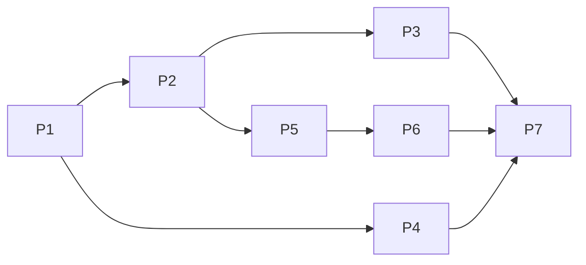

# Refactor giao diện chuyên nghiệp (client + admin), parallel

## Overview
CSS Modules + token. Animation lúc tải trang bằng CSS. `motion@14.10.1` chỉ cho tương tác sau hydrate (header cuộn, toast). `lucide-react@1.70.0`. Lookbook giữ bố cục đo từ ảnh mẫu, chỉ thêm animation. Admin: sidebar/rail/drawer, dark mode 3 trạng thái qua cookie, trang Tổng quan. API thêm list public, stats admin, 2 setting mới.
Nguồn chốt: [brainstorm](../reports/brainstorm-261107-0913-professional-ui-refactor-client-admin.md) · Research: [motion](./research/researcher-01-motion-animation-report.md), [admin shell](./research/researcher-02-admin-dashboard-shell-report.md)

## Phases
| Phase | Name | Status |
|-------|------|--------|
| 1 | [Foundation: token, palette, primitive, visual baseline](./phase-01-foundation-tokens-palette-baseline.md) | Done (không commit) |
| 2 | [API + shared contracts + web loaders](./phase-02-api-shared-contracts-and-loaders.md) | Done (không commit) |
| 3 | [Client shell & pages (/, /looks, /look/[slug])](./phase-03-client-shell-and-pages.md) | Done (không commit) |
| 4 | [Client animation (lookbook draw-once, route fade)](./phase-04-client-lookbook-animation.md) | Done (không commit) |
| 5 | [Admin shell, dark mode, Tổng quan](./phase-05-admin-shell-theme-overview.md) | Done (không commit) |
| 6 | [Admin screens responsive (list, editor, settings, users)](./phase-06-admin-screens-responsive.md) | Done (không commit) |
| 7 | [Tests, verification, docs](./phase-07-tests-verification-docs.md) | Done |

## Kết quả (chốt 2026-11-07)
- Xanh: `pnpm lint`, `pnpm typecheck`; `pnpm test` shared 37 / api 102 / web 265 passed; `pnpm e2e` 65/65 passed (visual 4/4 so với baseline P1, project mới `admin-shell`); Lighthouse SEO 100 mobile + desktop trên `/`, `/looks`, `/look/dramatic`.
- Báo cáo: [code-reviewer 8/10](../reports/code-reviewer-261107-1205-ui-refactor-review.md) (đã có vòng review-fix) · [ui-consistency verifying](../reports/ui-consistency-verifying-261107-1205-ui-refactor.md) · [tester e2e](../reports/tester-261107-0528-ui-refactor-e2e.md).
- Docs: 4 file `docs/` đã cập nhật 2026-11-07. Commit: bỏ theo quyết định chủ repo, không phase nào commit.
- Follow-up: (1) First Load JS delta của `motion` chưa đo; (2) visual baseline chỉ có win32 + `next dev`; (3) cookie `admin-theme` `secure` qua Caddy :8080 chưa kiểm runtime; (4) e2e page-2 poll 10s vì `revalidateTag` chạy sau khi trả response; (5) login rate limit 20 IP/15 phút, giới hạn số lần chạy e2e lặp; (6) dnd-kit hydration mismatch trong editor (có trước plan) và handle kéo 16×24: ngoài phạm vi.

## Dependency graph

- P4 không cần dữ liệu P2, chạy ngay sau P1, đồng thời với P2/P3 (file rời nhau).
- Critical path: P1 5h → P2 6h → P5 10h → P6 10h → P7 7h = 38h.

## Execution strategy
- Wave 1: P1 (tuần tự, chặn tất cả). Wave 2: P2 + P4. Wave 3: P3 ∥ (P5 → P6). Wave 4: P7.
- Mỗi phase kết thúc xanh: `pnpm lint`, `pnpm typecheck`, `pnpm test`, và spec visual P1 (`pnpm e2e --project visual`).
- Một phase = một hoặc vài commit riêng, revert độc lập. Không commit `apps/web/next-env.d.ts` (đang sửa sẵn, không thuộc plan).

## File ownership (tóm tắt, chi tiết: [file-ownership-matrix.md](./file-ownership-matrix.md))
| Phase | Sở hữu độc quyền |
|-------|------------------|
| 1 | `globals.css`, `design-tokens.css`, `client-theme-tokens.css`, `admin-theme-tokens.css`, `motion-primitives.module.css`, root `layout.tsx`, `apps/web/package.json`, `pnpm-lock.yaml`, `hooks/use-modal-dialog.ts`, `components/ui/*`, `components/motion/motion-provider.tsx`, `e2e/visual-reference-screenshots.spec.ts` + snapshots |
| 2 | `packages/shared/src/*`, `apps/api/**`, `infra/docker-compose.yml`, `.env.example`, `docs/deployment-guide.md`, `lib/seo/public-data-loaders.ts`, `app/admin/_lib/admin-api.ts` |
| 3 | `app/(public)/{layout,page,looks,look}`, `app/not-found.tsx`, `app/sitemap.ts`, `components/public/*`, `lib/seo/absolute-url.ts`, `lib/seo/build-looks-metadata.ts` |
| 4 | `components/lookbook/*`, `app/(public)/template.tsx`, `test/lookbook/*` |
| 5 | `app/admin/layout.tsx`, `app/admin/(protected)/{layout,page,loading}`, `(protected)/outfits/page.tsx`, `app/admin/login/*`, `_lib/admin-preference*`, `lib/admin-paths.ts`, `admin.module.css`, `admin-nav.tsx`, `logout-button.tsx`, `components/admin/{shell,overview}/*` |
| 6 | các file `components/admin/*` còn lại liên quan list/editor/settings/users, `hooks/admin/*`, `loading.tsx` con, `outfits/new/page.tsx` |
| 7 | `e2e/*` (trừ spec visual), `playwright.config.ts`, `docs/*` (trừ deployment-guide) |

## Quyết định đã chốt (2026-11-07)
Các mục 1, 6, 8, 9 đã chốt bên dưới. Các mục còn lại áp dụng mặc định như ghi.
1. `motion`: **giữ** `14.10.1`. Luật: không dùng cho trạng thái ẩn lúc SSR; chỉ cho tương tác sau hydrate (P3 header, P5 toast). Chi tiết: phase 1 Key Insights.
2. Màu admin dời khỏi `design-tokens.css` sang `admin-theme-tokens.css` (dùng `light-dark()`), lệch chút với "chỉ thêm token". Phương án dự phòng: giữ nguyên chỗ cũ + khối ghi đè dark.
3. Đổi spec visual sang chụp `[data-lookbook]` + `toHaveScreenshot` làm ở **P1** (chụp baseline trước khi UI đổi), không phải P7. Snapshot gắn hậu tố `win32`.
4. Đường dẫn list public: `GET /api/public/outfits?page&size` (cùng nhóm `/api/public/*` sẵn có), thay cho `/api/outfits` trong brainstorm.
5. "Mới nhất" = `updatedAt` giảm dần (+ `_id`), giống sitemap/admin. Nếu muốn thứ tự theo ngày tạo thì đổi sang `createdAt`.
6. **Chốt:** bỏ hiệu ứng "nhích lên" khi hover món trong lookbook: transform làm đường chỉ lệch khỏi ảnh. Giữ hover có sẵn (phóng ảnh, chỉ đậm, làm mờ món khác).
7. Redirect `/admin?q|status|page` → `/admin/outfits` đặt ở P5 (P5 sở hữu `(protected)/page.tsx`).
8. **Chốt:** chấp nhận mục "Outfit khác" trên `/look/<slug-khác>` cũ tối đa `PUBLIC_REVALIDATE_SECONDS` (300s) khi outfit khác đổi.
9. **Chốt:** header client hiện thẳng 2 link ở mọi màn hình, không nút ☰/dialog. Footer vẫn có link.
10. Env mới (mặc định): `PUBLIC_LOOKS_PAGE_SIZE`=12, `PUBLIC_RELATED_OUTFITS_COUNT`=8, `PUBLIC_PAGE_SIZE_MAX`=48, `ADMIN_STATS_RECENT_COUNT`=5.
11. Thẻ "Thiếu link affiliate" chỉ hiện số, chưa có bộ lọc riêng trong danh sách (thêm lọc = mở rộng phạm vi).
12. Bảng màu ứng viên ở P1 (đã tính tương phản). Logo: dùng chữ (tên site).
