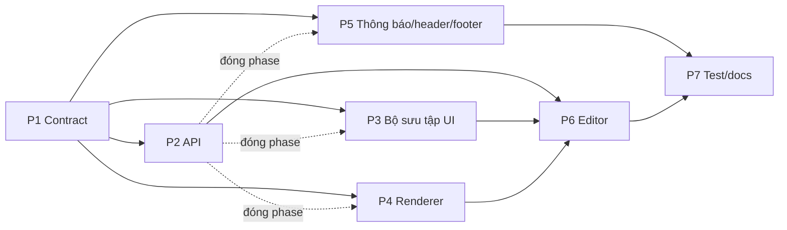

# Trang chủ section + Bộ sưu tập (parallel)
## Overview
Nguồn chốt: [brainstorm](../reports/brainstorm-261107-1341-homepage-sections-and-collections.md) (gồm "Đổi quyết định 5 (2026-11-07)") · [research builder](../reports/researcher-261107-1341-homepage-section-builder-options.md). Dữ liệu mới `Collection` + `page_layouts` (draft / published / một bản đăng trước). 7 loại section, dữ liệu section resolve ở API, web render bằng Server Component. Editor admin là registry tự làm (không Puck), một giao diện cho mọi bề rộng.

## Phases
| # | Phase | Effort | Chờ | Status |
|---|-------|--------|-----|--------|
| 1 | [Contract dùng chung + file hub + checklist UI + số đo "trước"](./phase-01-shared-contracts-and-ui-checklist.md) | 9h | — | Completed |
| 2 | [API: bộ sưu tập, bố cục (đăng/hoàn tác), settings](./phase-02-api-collections-home-layout-settings.md) | 17h | P1 | Completed |
| 3 | [Bộ sưu tập: admin + trang public](./phase-03-collections-admin-and-public-pages.md) | 13h | P1 (đóng sau P2) | Completed |
| 4 | [Renderer section + trang chủ public](./phase-04-home-section-renderers-and-home-page.md) | 12h | P1 (đóng sau P2) | Completed |
| 5 | [Dải thông báo, header/footer + form Cài đặt](./phase-05-settings-header-footer-shell.md) | 9h | P1 (đóng sau P2) | Completed |
| 6 | [Editor trang chủ admin (registry, desktop + mobile)](./phase-06-admin-homepage-editor.md) | 24h | P2, P3, P4 | Completed |
| 7 | [Test, kiểm chứng, docs](./phase-07-tests-verification-docs.md) | 11h | tất cả | In Progress |

## Dependency graph

- Nét đứt: code song song với P2 theo contract P1 (test bằng fixture), chỉ đóng khi chạy thật với API P2.
- Critical path: P1 9h → P2 17h → P6 24h → P7 11h = 61h. P3, P4, P5 nằm trong bóng của P2.

## Execution waves
- Wave 1: P1. Wave 2: P2 ∥ P3 ∥ P4 ∥ P5. Wave 3: P6. Wave 4: P7.
- Mỗi phase kết thúc xanh: `pnpm lint`, `pnpm typecheck`, `pnpm test`, `E2E_BASE_URL=http://localhost:3000 pnpm e2e --project visual` (không bao giờ `--update-snapshots`).
- Không commit từng phase. Commit một lần cuối đợt, chỉ khi chủ repo yêu cầu (tiếng Anh, conventional). Hoàn tác phase bằng git theo ma trận, thứ tự ngược.

## File ownership (chi tiết: [file-ownership-matrix.md](./file-ownership-matrix.md))
| Phase | Sở hữu chính |
|-------|--------------|
| 1 | `packages/shared/src/**`, `app/api/revalidate/route.ts`, `lib/admin-paths.ts`, `lib/seo/public-data-loaders.ts`, 3 file token CSS, `public-smart-link`, `collection-card*`, `scripts/perf/measure-first-load-js.mjs` |
| 2 | `apps/api/**` |
| 3 | `app/admin/(protected)/collections/**`, `components/admin/{collections,pickers}/*`, editor outfit (chọn bộ sưu tập), `app/(public)/collections/**`, `sitemap.ts`, `absolute-url.ts`, `looks-pagination.tsx`, `look-breadcrumb.tsx` |
| 4 | `components/home-sections/*`, `app/(public)/page.tsx`, `outfit-card-grid.tsx`, loader + JSON-LD trang chủ |
| 5 | `public-shell.tsx`, `public-copy.ts`, `site-announcement-bar*`, `site-header*`, `site-footer*`, `public-nav-items.ts`, `settings-form.tsx`, `components/admin/settings/*` |
| 6 | `app/admin/(protected)/home/**`, `app/admin/home-preview/**`, `components/admin/home-editor/**`, toast admin (`components/admin/shell/admin-toast*`, `use-admin-toast.ts`) |
| 7 | `e2e/**` (trừ spec visual), `playwright.config.ts`, `docs/*` |
Ngoại lệ tuần tự duy nhất: `admin-nav.tsx` + `admin-nav.test.tsx` (P3 thêm "Bộ sưu tập", sau đó P6 thêm "Trang chủ").
## Quyết định (2026-11-07)
1. Bỏ Puck hoàn toàn: không spike, không dependency mới. Editor registry tự làm dùng dnd-kit có sẵn, chạy ở mọi bề rộng (chủ repo cần sửa bố cục trên điện thoại). Public render bằng `HomeSectionList` tự viết.
2. JSON lưu dạng `[{ type, props: { id, visible, ... } }]` + `schemaVersion`. Collection `page_layouts`, `pageKey: 'home'`.
3. Dữ liệu section resolve một chỗ ở API: `GET /api/public/home` (bản đăng hoặc mặc định), `POST /api/admin/home/preview` (nháp trong editor).
4. Revalidate contract thêm `tags` (chỉ tag đã khai báo). `scope: 'all'` expire mọi tag.
5. Bố cục mặc định = trang chủ hiện tại (lookbook nổi bật + "Outfit khác" dạng lưới theo `relatedOutfitsCount`) + ô bộ sưu tập (tự ẩn khi chưa có).
6. Metadata trang chủ = metadata site. JSON-LD outfit giữ trong section lookbook nổi bật, thêm JSON-LD `FAQPage`.
7. Tab băng chuyền = nhóm radio + CSS, chạy không cần JS. Slider có nút tạm dừng (WCAG 2.2.2).
8. `/collections` dùng `looksPageSize`. Thứ tự bộ sưu tập chỉnh bằng Lên/Xuống. Outfit trong bộ sưu tập xếp mới nhất trước.
9. Trường mới của `PublicSettingsDto` và `Outfit.collectionIds` là optional để P1 không làm vỡ fixture; API luôn điền.
10. `lucide-react@1.70.0` không có icon thương hiệu → link mạng xã hội hiện chữ.
11. "Đăng" không hỏi xác nhận: toast "Hoàn tác" + menu "Hoàn tác lần đăng gần nhất". API giữ một bản đăng trước, `restore-previous` có lock, revalidate `/`. "Khôi phục bố cục mặc định" vẫn hỏi (xoá nháp).
12. Dải thông báo là cấu hình toàn site trong Cài đặt (mặc định tắt), hiện trên header public, không phải section trang chủ.
13. Link "Bộ sưu tập" trên header mặc định bật, tự ẩn khi chưa có bộ sưu tập đã đăng. Gỡ `getFeaturedOutfit` để follow-up.

## Kết quả (2026-11-07)
- Tiến độ: 5/7 phase Completed; P5 và P7 In Progress (còn follow-up). Plan: in-progress.
- Gate cuối: lint + typecheck xanh; unit shared 126, api 183, web 572; e2e 88/88 (gồm visual 4/4, không update snapshot).
- Bundle: `/` 199.1 KiB so với baseline 196.0 KiB (trong ngân sách +15 KiB); `/looks` 194.0 KiB = baseline.
- Review: code-reviewer 8/10, 0 critical (`plans/reports/code-reviewer-261107-homepage-sections-and-collections.md`). Tester: `plans/reports/tester-261107-homepage-sections-e2e.md`.
- Sửa sau review: publish nháp không đổi là no-op (giữ `previous`); giới hạn 24 bộ sưu tập/outfit (400), dọn khi race xoá; e2e content khôi phục settings + bố cục, từ chối host không phải localhost trừ khi `E2E_ALLOW_CONTENT_RESET=1`; sửa crash prop function ở trang sửa bộ sưu tập; tách shared/zod khỏi bundle public; meta description fallback cho `/` và `/collections/[slug]`.
- Dev-only: request đầu sau publish dưới `next dev` có thể stale; production đã kiểm đúng.
- Follow-up chưa làm (chưa tick):
  - (a) `.revealOnScroll` làm axe/Lighthouse báo color-contrast ở card dưới màn hình (palette 12.92:1).
  - (b) Editor/picker gọi API một lần cho mỗi id (N+1); cần filter `ids` ở list admin.
  - (c) Gợi ý review: khoá reset/revert-draft, wording xoá khi block nhiều bộ sưu tập, gộp FAQPage JSON-LD, field chrome public bắt buộc, dedupe `escapeRegex`/`isDuplicateKey`, vài file test/CSS >200 dòng.
  - (d) Lighthouse CLI chưa chạy (đã dùng axe-core).
  - (e) ui-consistency verifying độc lập chưa chạy (skill không có sẵn), làm thủ công.
  - (f) Đã xử lý: link mạng xã hội mở tab mới (`PublicSmartLink newTab`).
- Chưa commit.
